<div align="center">


# NextBoard

**A self-hosted board for running and directing AI coding agents.**

Claude Code, Codex, Gemini CLI or any other agent CLI as live terminal tiles on one canvas,<br>
on a machine you control, reachable from any browser.

[](https://github.com/azamrizki/nextboard/releases)
[](LICENSE)
[](go.mod)


[Why](#why-nextboard) · [How it works](#how-it-works) · [Features](#features) · [Screenshots](#screenshots) · [Quick start](#quick-start) · [Security](#security) · [Docs](#documentation)

<a href="docs/media/demo.mp4">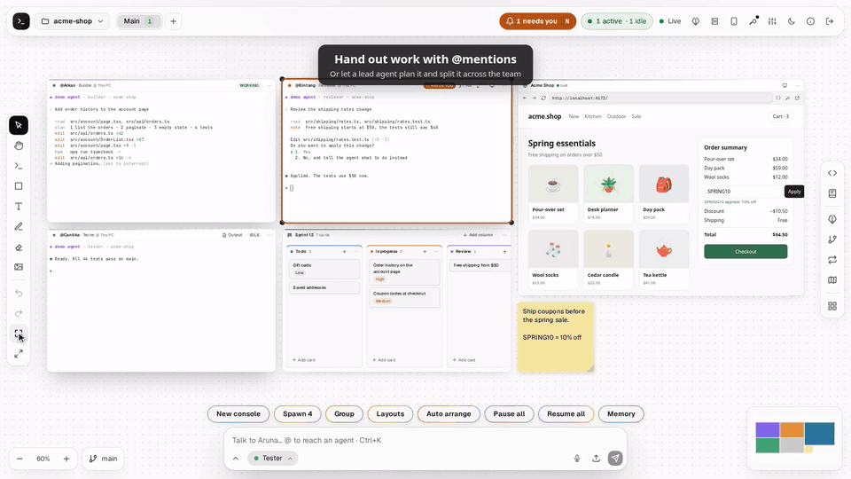</a>

▶ **[Watch the whole product tour](docs/media/demo.mp4)** (65 s, MP4)

</div>

> [!NOTE]
> **Beta.** All real-world testing so far was on Linux. macOS builds exist but are untested, and APIs and data formats can still change.

## Why NextBoard

- **See every agent at once.** Each console shows whether its agent is working, needs you or is ready, so you do not have to open terminals one by one to find the one that is waiting.
- **Agents keep running.** They run on your machine or your servers, not in the browser. Close the tab, and pick up later from another computer or your phone.
- **Everything around the agents in one place.** Hand out work, review the diff, preview the app, share project memory, and give an agent a credential without showing it the value.
- **Yours.** One Go binary, your machine, your agent subscriptions. No account, no cloud service in between.

## How it works

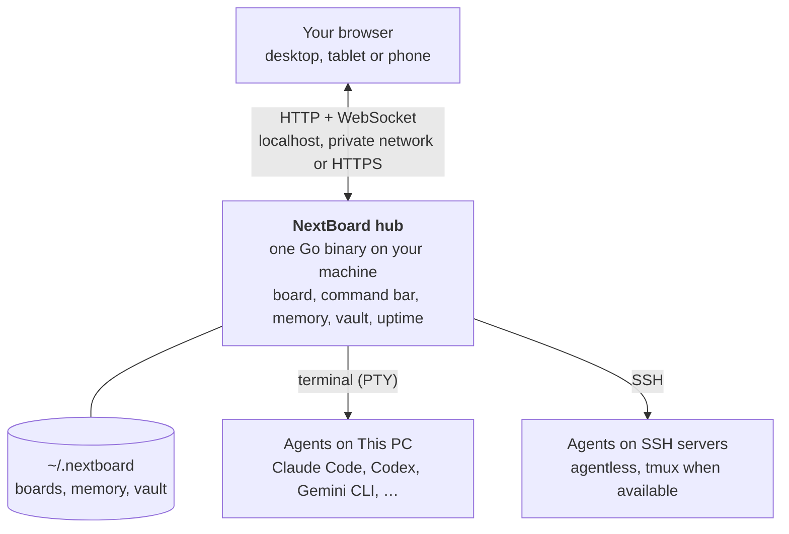

The hub starts each agent CLI in a terminal of its own, reads its screen to know its state, and types your orders into it. Nothing is installed on a server: the hub reaches it over SSH with your own keys.

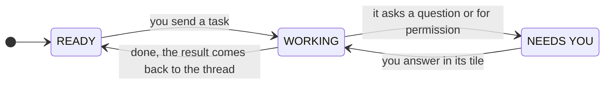

## Features

<table>
<tr>
<td width="50%" valign="top">

**🖥️ Board**<br>
Terminals, notes, checklists, kanban, calendar, shapes, pen, images, files and web pages on one infinite canvas. Synced live between clients, with undo, snapshots and auto arrange.

</td>
<td width="50%" valign="top">

**🤖 Agents**<br>
Live `WORKING` / `NEEDS YOU` / `READY`, exact conversation resume, and model and effort per console. Claude Code and Codex are the most tested; Gemini CLI, OpenCode and 16 more CLIs from the catalog (Aider, Amp, GitHub Copilot CLI, Goose, Qwen Code, …) work with less testing, and any other CLI can be added.

</td>
</tr>
<tr>
<td valign="top">

**🧭 Orchestration**<br>
A command bar with `@mentions`, and a lead agent that plans with your own local `claude -p`. Groups, handoffs, result forwarding, loops, task boards and a mission map. 44 layout templates deploy a whole team, with the consoles per group chosen first. Commands work in English and Indonesian.

</td>
<td valign="top">

**🧠 Project memory**<br>
One memory per project, shared by every CLI, with required critical notes, sub-memories and a galaxy view. A memory tile stacks memory from other projects, and each agent is only sent what it does not have yet.

</td>
</tr>
<tr>
<td valign="top">

**💻 Code workbench**<br>
A Monaco editor card with language servers and debuggers (Delve, debugpy, Node.js, attaching to a running process too), git staging, stash and conflicts, pull requests through `gh`, review of agent changes, local history and a Laravel view. Open VSX themes and grammars load as data; extension code never runs.

</td>
<td valign="top">

**🌐 Git, previews and browsers**<br>
A git panel and branch cards, localhost previews (from SSH servers too), and a real browser in a tile for sites that refuse to load in a frame: NextBoard Chromium, which the hub downloads and keeps up to date and which loads the passkey extension by itself, or the Chrome, Chromium or Firefox installed on This PC.

</td>
</tr>
<tr>
<td valign="top">

**🔐 Credentials vault**<br>
Zero-knowledge, like a password manager: encrypted in your browser, ciphertext on the hub. An agent can use a secret through one command you approve, without seeing its value. Passkeys for sites too.

</td>
<td valign="top">

**📈 Uptime monitors**<br>
HTTP, TCP, ping, DNS, push, WebSocket, Docker and game-server checks with maintenance windows, alerts and a webhook, and an optional public status page that shows no hosts or errors.

</td>
</tr>
<tr>
<td valign="top">

**🛰️ SSH machines and desktop apps**<br>
Agentless SSH with tmux when available, so sessions survive disconnects. On Linux, GUI apps run on a virtual display and stream to a tile, with sound, microphone and keyboard shortcuts.

</td>
<td valign="top">

**📱 Phones and tablets**<br>
Every page, the board and every card have their own phone and tablet layouts, with a Cards list beside the canvas and key bars for consoles and the editor. Installs as an app over HTTPS.

</td>
</tr>
</table>

Also: studios (documents to PDF, diagrams, a Markdown vault with a link graph, a skills manager), usage and token charts, voice input and notifications.

## Screenshots

| | |
|---|---|
| 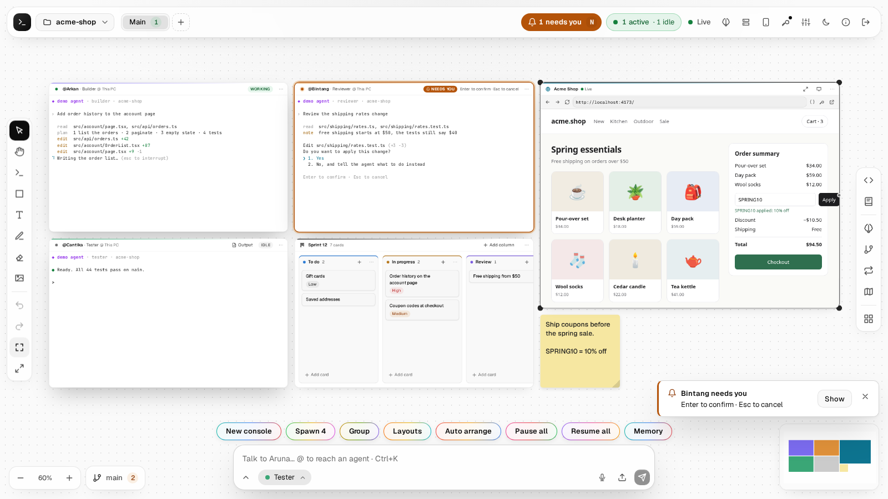<br>Agents, cards and a live preview on one board | 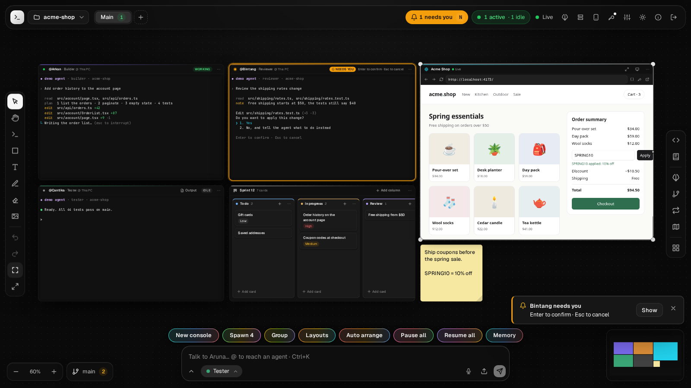<br>The same board in the dark theme |
| 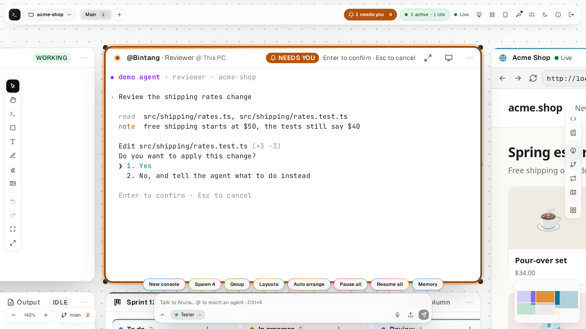<br>An agent that needs you, answered in its own tile | 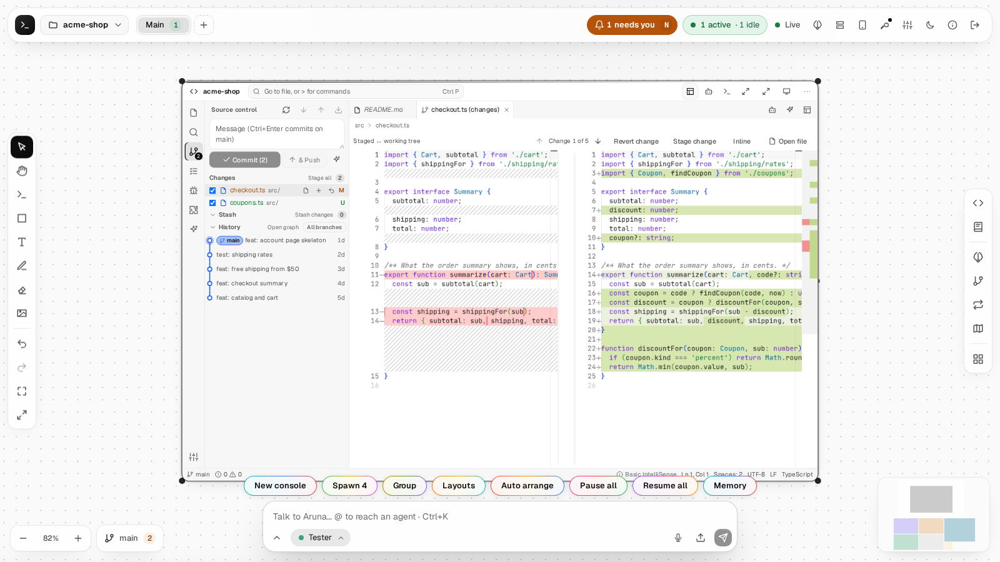<br>The code card on an agent's change |
| 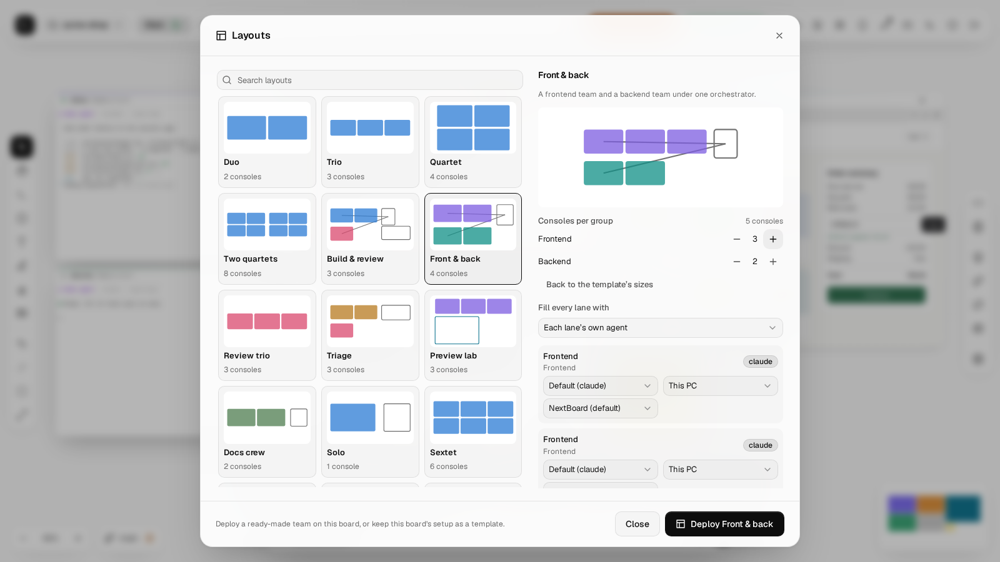<br>Layouts, with the consoles per group set before deploying | 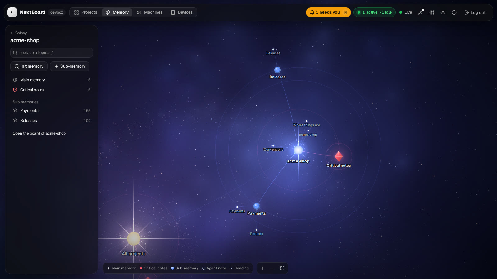<br>Project memory as a galaxy |
| 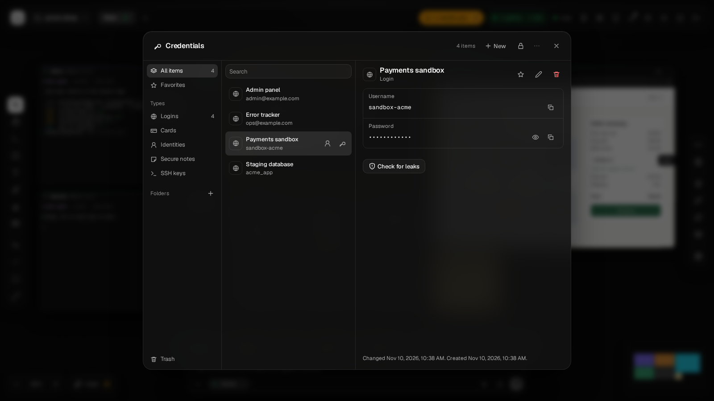<br>The credentials vault | 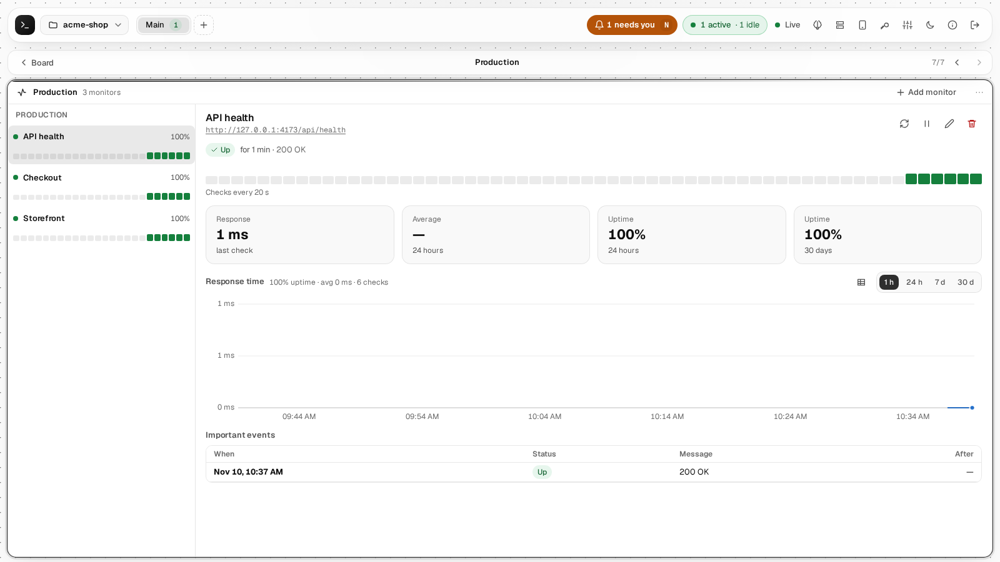<br>Uptime monitors |
| 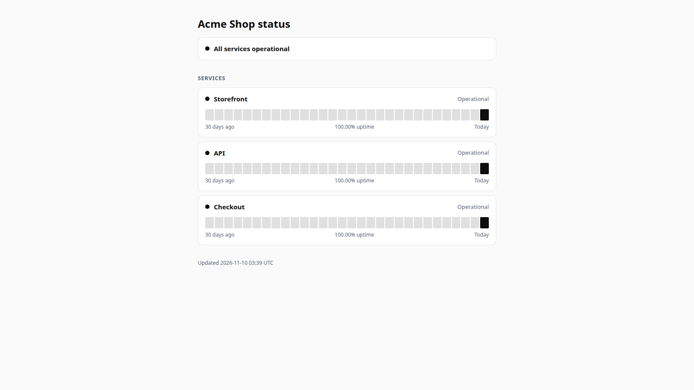<br>The public status page | 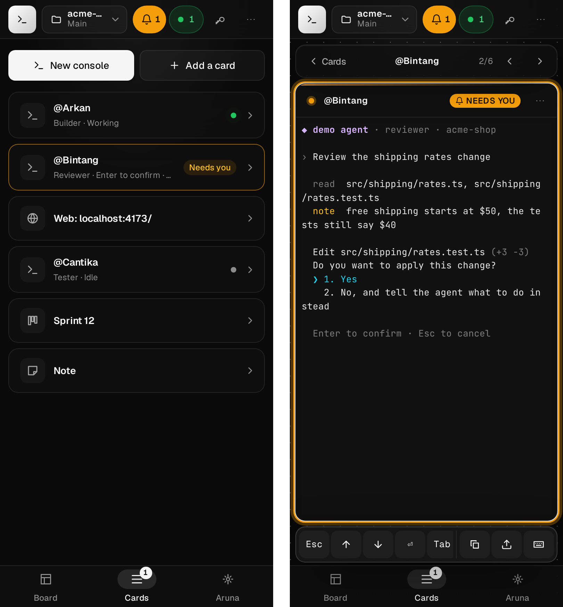<br>On a phone: the Cards list, and a console with its key bar |

Every screenshot and the video come from a demo hub with made-up projects and scripted agents, which `make demo` records again ([web/demo](web/demo)).

## Quick start

**1. Install an agent CLI** you already use, such as [Claude Code](https://github.com/anthropics/claude-code) or [Codex](https://github.com/openai/codex), and log in to it.

**2. Install NextBoard:**

```bash
curl -fsSL https://raw.githubusercontent.com/azamrizki/nextboard/main/install.sh | sh
```

This puts the binary in `~/.local/bin`, checks its checksum, sets up a service (systemd user service on Linux, LaunchAgent on macOS) and prints a one-time setup link, valid for 30 minutes. Add `-s -- --no-service` after `sh` to install the binary only.

**3. Open the setup link**, choose the admin password and name your hub. Lost the link? `nextboard setup-link` makes a new one.

**4. Add a project and start consoles.** The hub listens on `http://127.0.0.1:12312` and keeps its data in `~/.nextboard`. To reach it from other devices, see [Security](#security).

`nextboard update` installs newer stable releases.

**Betas** are published as GitHub pre-releases, and `nextboard update` never installs one by itself. To try one, pick its tag on the [releases page](https://github.com/azamrizki/nextboard/releases):

```bash
nextboard update --version v0.4.0-beta.1
# or, for a new install
curl -fsSL https://raw.githubusercontent.com/azamrizki/nextboard/main/install.sh | sh -s -- --version=v0.4.0-beta.1
```

<details>
<summary><b>Build from source</b></summary>

You need Go 1.26+, Node 22+ and git.

```bash
git clone https://github.com/azamrizki/nextboard.git
cd nextboard
make build
./bin/nextboard serve     # prints the setup link in a terminal
./bin/nextboard install   # or run it as a service
```

Do not use `go install`. It builds a hub without the web UI, because the built bundle is not in the repository.

</details>

<details>
<summary><b>Optional tools</b></summary>

| Tool | Used for |
|---|---|
| `tmux` on a server | Sessions that survive SSH disconnects and hub restarts |
| `gh` | Publishing to GitHub and pull requests |
| Language servers and debuggers (`gopls`, `pyright`, `typescript-language-server`, `dlv`, `debugpy`, ...) | The code workbench; each is used when found on `PATH` |
| `sway`, `wayvnc`, `wf-recorder`, `xwayland` | Desktop apps in a tile, with GPU |
| `tigervnc-standalone-server`, `openbox` | Desktop apps in a tile, without GPU |
| `ffmpeg` with VA-API, PipeWire | Hardware video and sound in desktop tiles |

</details>

## Security

> [!WARNING]
> **NextBoard is effectively a shell on your machine. Do not expose its port to the internet.**

- The hub speaks plain HTTP and binds to `127.0.0.1` by default. For remote access, put it behind HTTPS with nginx (`deploy/nginx.conf.example`) or use a private network such as Tailscale. `tailscale serve` only forwards the main port, so web tiles do not work through it.
- `make dev` binds to `0.0.0.0` by default. On an untrusted network, use `make dev LISTEN=127.0.0.1:12312`.
- Agents run as your user and can read everything your user can, including NextBoard's data folder. Critical notes are instructions to agents, not a technical lock. Blocked commands make the CLI itself ask you first, but they are not a sandbox: an agent with a shell can still write a script that does the same.
- The credentials vault encrypts in the browser and the hub stores only ciphertext. If you forget the master password, the contents are gone. Letting agents use a credential guards against accidents, not against an agent set on stealing it. See [docs/API-vault.md](docs/API-vault.md) for what it does not protect against.
- Only the status page may face the internet, on a listener of its own (`--status-listen`). It shows the names you chose for your monitors and their uptime, and never a host, an address or an error message.

Please report security problems through a [private security advisory](https://github.com/azamrizki/nextboard/security/advisories/new), not a public issue.

## CLI

| Command | Purpose |
|---|---|
| `nextboard serve [--listen addr]` | Run in the foreground |
| `nextboard install` / `uninstall [--purge]` | Install or remove the service |
| `nextboard status` | Service state, address, and session, machine and device counts |
| `nextboard logs [-f]` | Service logs |
| `nextboard connlog` | Server connection history: drops, reconnects, latency |
| `nextboard setup-link` | Create a new one-time setup link |
| `nextboard reset-password` | Reset the admin password |
| `nextboard pair` | Print a QR code and pairing code for a device |
| `nextboard update [--version tag]` | Install the latest stable release, or the one named, and restart the service |
| `sudo nextboard browser-sandbox` | Let NextBoard Chromium make its sandbox where Ubuntu 23.10+ restricts it; only needed without a Chrome or Chromium installed from a package |
| `nextboard version` | Print the version |

All commands accept `--data-dir` (default `~/.nextboard`, or `$NEXTBOARD_HOME`).

## Development

```bash
make dev        # hub and Vite together; needs air (go install github.com/air-verse/air@latest)
                # web http://localhost:15173, hub http://localhost:12312, data in ./.devdata
make dev-hub    # hub only
make dev-web    # Vite only
make test       # go vet + go test -race
make test-web   # web unit tests; needs web/node_modules
make test-e2e   # browser tests with fake agents; needs `cd web && npx playwright install chromium` once
make test-ssh   # SSH tests against a throwaway local sshd
make demo       # the screenshots and the video in docs/media, from a hub of made-up data; needs ffmpeg
make build      # web + bin/nextboard
make snapshot   # goreleaser build for linux/darwin, amd64/arm64
```

By default the tests never touch a real agent CLI or your agent plan. `NEXTBOARD_REAL_CLI_TEST=1` turns on tests that do, and these use your real account.

<details>
<summary><b>Releases</b></summary>

While NextBoard is in development, CI runs only as part of a release, so run the tests yourself before you push. A release is started by hand from GitHub Actions: it runs all the tests, works out the version from the commit messages with [semantic-release](https://semantic-release.gitbook.io/), tags it and publishes the binaries with goreleaser.

Commits use [Conventional Commits](https://www.conventionalcommits.org/): `fix:` gives a patch release, `feat:` a minor one, and `docs:`, `test:`, `ci:` and `chore:` no release. Until 1.0, a breaking change (`feat!:`) also gives a minor release.

A beta comes from the `beta` branch: bring it up to `main` (`git push origin main:beta`) and run the release workflow on it (`gh workflow run release.yml --ref beta`). It is tagged `vX.Y.Z-beta.N` and published as a pre-release, so `nextboard update` and the install script keep giving the last stable release.

</details>

<details>
<summary><b>Repository layout</b></summary>

```
cmd/nextboard/      entry point
internal/server/    router, auth middleware, REST, WebSocket
internal/session/   terminals, scrollback, resume
internal/machine/   local PTY and agentless SSH
internal/agent/     agent catalog, status, hooks
internal/orch/      command bar, planner, orders, loops, memory
internal/delivery/  typing orders into consoles
internal/studio/    code workbench and studios
internal/gitsvc/    git panel and GitHub
internal/preview/   web tile proxy
internal/gui/       desktop apps in a tile
internal/vault/     credentials vault storage
web/                React + TypeScript + Vite UI
web/demo/           the made-up hub behind the screenshots and the video
docs/               specification and API contracts
deploy/             nginx, systemd and launchd examples
```

Android and desktop clients exist as separate projects. They are paused while the hub stabilizes and are not part of this repository.

</details>

## Documentation

The detailed docs are written in Indonesian. Start with [docs/PROJECT.md](docs/PROJECT.md).

| Document | Contents |
|---|---|
| [PROJECT.md](docs/PROJECT.md) | Overview: how it works, features, limits, status and known gaps |
| [SPEC.md](docs/SPEC.md) | Original specification: network, auth, SSH |
| [ROADMAP.md](docs/ROADMAP.md) | Phases and design decisions |
| [DESIGN.md](docs/DESIGN.md) | Design system |
| [API.md](docs/API.md), [API-board.md](docs/API-board.md), [API-agents.md](docs/API-agents.md), [API-orchestration.md](docs/API-orchestration.md), [API-studio.md](docs/API-studio.md), [API-gui.md](docs/API-gui.md), [API-vault.md](docs/API-vault.md), [API-uptime.md](docs/API-uptime.md) | HTTP and WebSocket contracts |

## Contributing

Issues and pull requests are welcome. Please run `make test` and `make test-web` before opening a pull request, since CI does not run on it, use [Conventional Commits](https://www.conventionalcommits.org/), and keep the matching `docs/API*.md` accurate when a contract changes.

## License

[MIT](LICENSE) © 2026 Azam Rizki

Third-party components keep their own licenses. Most dependencies are MIT, ISC, BSD or Apache-2.0. Others include noVNC (MPL-2.0), DOMPurify (MPL-2.0 or Apache-2.0), and the Geist, Geist Mono, JetBrains Mono and Caveat fonts (OFL-1.1).

Agent names and logos belong to their owners and are used only to identify those tools. NextBoard is not affiliated with or endorsed by any of them.
