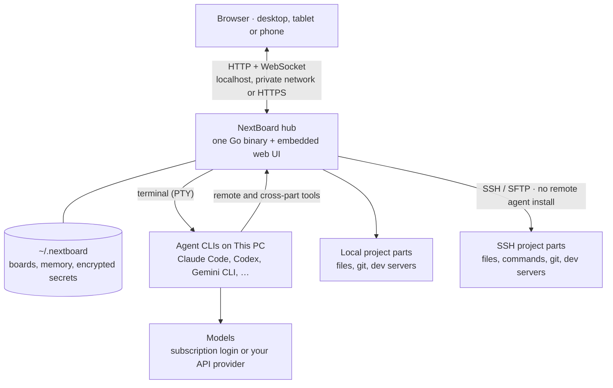
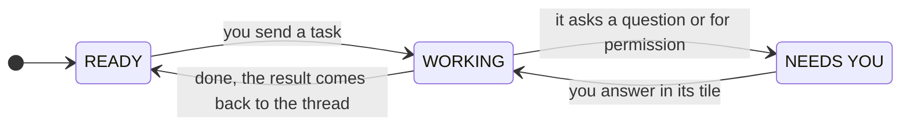

<div align="center">


# NextBoard

### Your agents. Your machines. One board.

A self-hosted workspace for running and directing AI coding agents.<br>
Bring your terminals, code, project memory and live previews onto one canvas.<br>
Work across local folders and SSH servers, from any browser.

[](https://github.com/azamrizki/nextboard/releases/latest)
[](LICENSE)
[](go.mod)


**[Quick start](#quick-start)** · [Project parts](#projects-with-several-parts) · [Features](#features) · [Screenshots](#screenshots) · [Documentation](#documentation)

[How it works](#how-it-works) · [API providers](#api-providers) · [Security](#security) · [Development](#development)

<a href="docs/media/demo.mp4"></a>

<sub>Send work with an @mention, watch the agent work and read its report.</sub>

**[▶ Watch the product tour](docs/media/demo.mp4)** (65 s, MP4) · [Releases](https://github.com/azamrizki/nextboard/releases) · [Report an issue](https://github.com/azamrizki/nextboard/issues)

</div>

> [!NOTE]
> **Beta.** Real-world testing has been on Linux; macOS builds are available but untested. APIs and data formats may change. This README describes the current source tree, which may include features newer than the latest release.

## Why NextBoard

- **See every agent at once.** Each console shows whether its agent is working, needs you or is ready, so you do not have to open terminals one by one to find the one that is waiting.
- **Agents keep running.** Their processes live on the hub machine, so closing the browser leaves work running. Pick up later from another computer or your phone.
- **One project, even across machines.** Keep a frontend, backend and worker together as named parts, each with its own folder, git state and code workbench, sharing one memory and lead agent.
- **Everything around the agents in one place.** Hand out work, review the diff, preview the app, share project memory, and let an agent use a credential through a command you approve.
- **Yours.** One Go binary, your machine, your agent subscriptions or your own API keys. No account, no cloud service in between.

## Quick start

**1. Install an agent CLI** you already use, such as [Claude Code](https://github.com/anthropics/claude-code) or [Codex](https://github.com/openai/codex), and log in to it.

**2. Install NextBoard:**

```bash
curl -fsSL https://raw.githubusercontent.com/azamrizki/nextboard/main/install.sh | sh
```

This puts the binary in `~/.local/bin`, checks its checksum, sets up a service (systemd user service on Linux, LaunchAgent on macOS) and prints a one-time setup link, valid for 30 minutes. Add `-s -- --no-service` after `sh` to install the binary only.

**3. Open the setup link**, choose the admin password and name your hub. Lost the link? `nextboard setup-link` makes a new one.

**4. Add a project and start consoles.** Choose one folder, or add several named parts across your machines. Start an agent in the part you want it to work on, then send it a task from its tile or the command bar.

| Default | Value |
|---|---|
| Hub address | `http://127.0.0.1:12312` |
| Data directory | `~/.nextboard` |
| Browser access | Desktop, tablet or phone; see [Security](#security) for remote access |

`nextboard update` installs newer stable releases.

<details>
<summary><b>Try a beta release</b></summary>

Betas are GitHub pre-releases; `nextboard update` never installs one automatically. Replace `vX.Y.Z-beta.N` below with a tag from the [releases page](https://github.com/azamrizki/nextboard/releases):

```bash
nextboard update --version vX.Y.Z-beta.N
# or, for a new install
curl -fsSL https://raw.githubusercontent.com/azamrizki/nextboard/main/install.sh | sh -s -- --version=vX.Y.Z-beta.N
```

</details>

<details>
<summary><b>Build from source</b></summary>

You need Go 1.26+, Node 22+ and git.

```bash
git clone https://github.com/azamrizki/nextboard.git
cd nextboard
make build
./bin/nextboard serve     # prints the setup link in a terminal
./bin/nextboard install   # or run it as a service
```

Do not use `go install`. It builds a hub without the web UI, because the built bundle is not in the repository.

</details>

<details>
<summary><b>Optional tools</b></summary>

| Tool | Used for |
|---|---|
| `tmux` on a server | Sessions that survive SSH disconnects and hub restarts |
| `bubblewrap` (`bwrap`) | Claude Code's sandbox, and keeping an API provider's key out of the commands Claude Code runs |
| `gh` | Publishing to GitHub and pull requests |
| Language servers and debuggers (`gopls`, `pyright`, `typescript-language-server`, `dlv`, `debugpy`, ...) | The code workbench; each is used when found on `PATH` |
| `sway`, `wayvnc`, `wf-recorder`, `xwayland` | Desktop apps in a tile, with GPU |
| `tigervnc-standalone-server`, `openbox` | Desktop apps in a tile, without GPU |
| `ffmpeg` with VA-API, PipeWire | Hardware video and sound in desktop tiles |

</details>

## Projects with several parts

A project can span **up to eight named parts**, each a folder on This PC or an SSH machine. Keep a product together even when its repositories live in different places:

| Part | Machine | Folder |
|---|---|---|
| Frontend | This PC | `~/apps/shop-web` |
| Backend | API server | `/srv/shop-api` |
| Worker | Worker server | `/srv/shop-worker` |

**Shared across the project:** memory, critical notes, lead agent, boards, tasks and credentials. **Scoped to each part:** consoles, files, git, workbench tabs, review and local history. Uptime monitors can target a part while staying on the project's monitoring page.

- **Start together.** The Add project form accepts one or several parts. For an existing project, open its menu → **Parts…** to add, rename or reorder them.
- **Direct work by part.** For example, `spawn 2 claude in Backend` opens consoles for that part. The lead knows each console's part, and Mission Map can filter by part.
- **Choose agent access.** An agent can edit its assigned part and other writable parts on the same machine. Access to parts on other machines starts read-only; enable full access when needed. Mark individual parts read-only or add commands that require approval. These hub rules have [security limits](#security).
- **Merge without restarting consoles.** Bring another project's parts, boards, terminals, monitors, loops, memory, review history and lead thread into one project. The dialog previews what moves and lets you include its critical notes. Unlock the vault before merging to transfer its agent credential permissions too.
- **Split a part out.** Close its terminals, then make it a project of its own with an empty board, its review and local history. Existing boards, memory and monitors stay with the original project.

Merge and split leave folders and files in place. See [project and part contracts](docs/API-board.md) for the exact behavior.

## Features

<table>
<tr>
<td width="50%" valign="top">

**🖥️ An infinite workspace**

Terminals, notes, checklists, kanban, calendars, drawings, images, files and web pages. Live sync, undo, snapshots and auto arrange keep the board usable as it grows.

</td>
<td width="50%" valign="top">

**🤖 Agents at a glance**

Live `WORKING` / `NEEDS YOU` / `READY` states, conversation resume for supported CLIs, and model and effort selection per console. Use your subscription or an API provider with cost tracking and monthly budgets.

</td>
</tr>
<tr>
<td valign="top">

**🧭 A lead for your team**

Direct agents with `@mentions` or ask the lead to plan by project part. Groups, handoffs, result forwarding, loops, task boards and a Mission Map keep work connected. Deploy teams from layout templates. Commands work in English and Indonesian.

</td>
<td valign="top">

**🧠 Shared project memory**

One memory across agents and project parts, with critical notes, sub-memories and a galaxy view. Stack memory from other projects in a tile; send each agent only the context it does not have yet.

</td>
</tr>
<tr>
<td valign="top">

**💻 A code workbench per part**

Monaco, language servers, debuggers, git staging, stash, conflicts and pull requests through `gh`. Review agent changes and local history per part. Includes a Laravel view and Open VSX themes and grammars loaded as data; extension code never runs.

</td>
<td valign="top">

**🌐 Live previews and browsers**

Preview dev servers on This PC or over SSH. For sites that refuse iframes, use a real browser tile: hub-managed NextBoard Chromium, or an installed Chrome, Chromium or Firefox. GUI tiles require Linux.

</td>
</tr>
<tr>
<td valign="top">

**🔐 A credentials vault**

Encrypt credentials in your browser; store only ciphertext on the hub. Approve a command that uses a secret without putting its value in the agent's prompt. Includes passkeys for websites.

</td>
<td valign="top">

**📈 Uptime beside your code**

HTTP, TCP, ping, DNS, push, WebSocket, Docker and game-server checks. Attach monitors to parts, schedule maintenance and receive alerts. Publish a separate status page without exposing hosts or error details.

</td>
</tr>
<tr>
<td valign="top">

**🛰️ Local and remote machines**

Reach server files, git and commands over agentless SSH. Keep logins on This PC. On Linux, stream desktop apps from a virtual display into tiles, with sound, microphone and keyboard shortcuts.

</td>
<td valign="top">

**📱 A workspace that travels**

Phone and tablet layouts, a Cards list alongside the canvas, and key bars for terminals and the editor. Install the web UI as an app over HTTPS and reconnect to work that keeps running on the hub.

</td>
</tr>
</table>

Also included: document-to-PDF and diagram studios, a Markdown vault with a link graph, a skills manager, usage and token charts, voice input and notifications.

### Agent support

| Agent | Integration |
|---|---|
| **Claude Code · Codex** | Most tested; live status, exact conversation resume, project memory, remote tools and API providers |
| **OpenCode** | Remote tools and API providers; less real-world testing |
| **Gemini CLI** | Built-in preset with screen-based status; less real-world testing |
| **Catalog and custom CLIs** | Aider, Amp, GitHub Copilot CLI, Goose, Qwen Code and more; capabilities vary by CLI |

See [agent contracts and verification notes](docs/API-agents.md) for individual capabilities and limits.

## How it works



The hub starts each agent CLI in its own terminal on **This PC**, tracks its state and delivers your orders. For remote projects, Claude Code, Codex and OpenCode use hub tools to read files and run commands over SSH; their CLI, login and memory stay on the hub machine. Servers need SSH access, with no NextBoard service or agent CLI to install. Plain SSH shells can use tmux to survive disconnects.



## Screenshots

| Direct your agents | Review their work |
|:---:|:---:|
|  |  |
| Answer an agent in its own tile | Inspect changes in the code workbench |

| Deploy a team | Share project context |
|:---:|:---:|
|  |  |
| Choose a layout and size each group | Explore shared memory and its connections |

<details>
<summary><b>More views — vault, uptime, public status and mobile</b></summary>

| Credentials vault | Uptime monitors |
|:---:|:---:|
|  |  |

| Public status page | On your phone |
|:---:|:---:|
|  |  |

</details>

<details>
<summary><b>The board — light and dark themes</b></summary>

<picture>
  <source media="(prefers-color-scheme: dark)" srcset="docs/media/board-dark.png">
  <source media="(prefers-color-scheme: light)" srcset="docs/media/board-light.png">
  
</picture>

[View light theme](docs/media/board-light.png) · [View dark theme](docs/media/board-dark.png)

</details>

These captures use a demo hub with fictional projects and scripted agents. Recreate them with `make demo` ([web/demo](web/demo)); they illustrate the core workflow and may not show the latest additions.

## API providers

Run Claude Code, Codex or OpenCode on an API key of your own instead of a subscription login. Claude Code and Codex get a config folder of their own per provider, so your logins are neither used nor changed.

| Agent | Needs |
|---|---|
| Claude Code | An Anthropic-compatible API (`/v1/messages`) |
| Codex | An OpenAI-compatible API **with the Responses API** (`/v1/responses`); Codex no longer speaks Chat Completions |
| OpenCode | Either |

1. **Settings › API providers › Add provider**: the address, the key, a default model, and optionally prices per model and a monthly budget. **Test the connection** lists its models.
2. **Start a console on it**: pick **API · *name*** where you choose the login (new console, spawn, layouts, handoff, switch agent). The tile shows **API · $cost**.
3. **Optional**: Settings › Lead agent › *What it runs on* puts the lead on a provider, and gives the consoles it starts a default provider per agent. Settings › Previews & studios › *Run through* does the same for the other hidden runs (memory, summaries, commit messages, documents).

Once a month's budget is spent, new consoles, restarts and hidden runs on that provider are refused; nothing moves to your subscription by itself. Claude Code consoles on a provider start in *accept edits* mode, because its default auto mode checks each action on Anthropic's servers, which a gateway does not reach.

## Security

> [!WARNING]
> **NextBoard is effectively a shell on your machine. Do not expose its port to the internet.**

- The hub speaks plain HTTP and binds to `127.0.0.1` by default. For remote access, put it behind HTTPS with nginx (`deploy/nginx.conf.example`) or use a private network such as Tailscale. `tailscale serve` only forwards the main port, so web tiles do not work through it.
- `make dev` binds to `0.0.0.0` by default. On an untrusted network, use `make dev LISTEN=127.0.0.1:12312`.
- **Agent access.** Agents run as your user and can read everything that user can, including NextBoard's data folder. Critical notes, blocked commands and read-only part settings are not an OS security boundary: a CLI's own local tools may reach other folders on the same machine. Read the [agent access rules](docs/API-agents.md#211-part-project-roadmap-49) before relying on these controls.
- **Project sandbox.** In Memory › Critical notes › Sandbox, restrict local Codex and Claude Code commands to the working folder, temporary folders and package caches, with or without network. Codex needs no extra tool; Claude Code needs bubblewrap and, on affected Ubuntu systems, an AppArmor configuration step. Other CLIs, SSH work and tools outside the CLI's shell sandbox have different limits; see [sandbox behavior and limitations](docs/API-agents.md#27-sandbox-agen-2026-11-11).
- The credentials vault encrypts in the browser and the hub stores only ciphertext. If you forget the master password, the contents are gone. Letting agents use a credential guards against accidents, not against an agent set on stealing it. See [docs/API-vault.md](docs/API-vault.md) for what it does not protect against.
- API provider keys are sealed with the hub's master key and given only to the agent process that uses them, never to a browser, a command line or a log. The commands an agent runs do not get the key with Codex, nor with Claude Code when `bubblewrap` is installed; OpenCode's commands still do. An agent set on finding it can still read it from its own CLI's process.
- Only the status page may face the internet, on a listener of its own (`--status-listen`). It shows the names you chose for your monitors and their uptime, and never a host, an address or an error message.

Please report security problems through a [private security advisory](https://github.com/azamrizki/nextboard/security/advisories/new), not a public issue.

## CLI

| Command | Purpose |
|---|---|
| `nextboard serve [--listen addr]` | Run in the foreground |
| `nextboard install` / `uninstall [--purge]` | Install or remove the service |
| `nextboard status` | Service state, address, and session, machine and device counts |
| `nextboard logs [-f]` | Service logs |
| `nextboard connlog` | Server connection history: drops, reconnects, latency |
| `nextboard setup-link` | Create a new one-time setup link |
| `nextboard reset-password` | Reset the admin password |
| `nextboard pair` | Print a QR code and pairing code for a device |
| `nextboard update [--version tag]` | Install the latest stable release, or the one named, and restart the service |
| `sudo nextboard browser-sandbox` | Let NextBoard Chromium make its sandbox where Ubuntu 23.10+ restricts it; only needed without a Chrome or Chromium installed from a package |
| `nextboard version` | Print the version |

All commands accept `--data-dir` (default `~/.nextboard`, or `$NEXTBOARD_HOME`).

`serve --debug-listen 127.0.0.1:6060` serves the hub's Go profiles and a few counts (`/debug/pprof/`, `/debug/hub`) for looking into its memory. It is off unless given, takes only a loopback address, and answers no request from a web page.

## Development

Use **Go 1.26+**, **Node.js 22+** and git. From a source checkout, install the frontend dependencies and the Go reloader:

```bash
npm ci --prefix web
go install github.com/air-verse/air@latest
make dev
```

The web UI runs at `http://localhost:15173`, the hub at `http://localhost:12312`, and development data lives in `./.devdata`.

```bash
make dev        # hub and Vite together, with live reload
make dev-hub    # hub only
make dev-web    # Vite only
make test       # go vet + go test -race
make test-web   # web unit tests; needs web/node_modules
make test-e2e   # browser tests with fake agents; needs `cd web && npx playwright install chromium` once
make test-ssh   # SSH tests against a throwaway local sshd
make demo       # the screenshots and the video in docs/media, from a hub of made-up data; needs ffmpeg
make build      # web + bin/nextboard
make snapshot   # goreleaser build for linux/darwin, amd64/arm64
```

By default the tests never touch a real agent CLI or your agent plan. `NEXTBOARD_REAL_CLI_TEST=1` turns on tests that do, and these use your real account.

<details>
<summary><b>Releases</b></summary>

While NextBoard is in development, CI runs only as part of a release, so run the tests yourself before you push. A release is started by hand from GitHub Actions: it runs all the tests, works out the version from the commit messages with [semantic-release](https://semantic-release.gitbook.io/), tags it and publishes the binaries with goreleaser.

Commits use [Conventional Commits](https://www.conventionalcommits.org/): `fix:` gives a patch release, `feat:` a minor one, and `docs:`, `test:`, `ci:` and `chore:` no release. Until 1.0, a breaking change (`feat!:`) also gives a minor release.

A beta comes from the `beta` branch: bring it up to `main` (`git push origin main:beta`) and run the release workflow on it (`gh workflow run release.yml --ref beta`). It is tagged `vX.Y.Z-beta.N` and published as a pre-release, so `nextboard update` and the install script keep giving the last stable release.

</details>

<details>
<summary><b>Repository layout</b></summary>

```
cmd/nextboard/      entry point
internal/server/    router, auth middleware, REST, WebSocket
internal/session/   terminals, scrollback, resume
internal/machine/   local PTY and agentless SSH
internal/project/   projects, groups, parts, merge and split
internal/agent/     agent catalog, status, hooks
internal/orch/      command bar, lead and planner, orders, loops, memory
internal/jobs/      hidden runs of the agent CLIs (planner, summaries, commit messages)
internal/providers/ API providers: sealed keys, prices, budgets
internal/delivery/  typing orders into consoles
internal/studio/    code workbench and studios
internal/gitsvc/    git panel and GitHub
internal/preview/   web tile proxy
internal/gui/       desktop apps in a tile
internal/vault/     credentials vault storage
internal/uptime/    monitors, alerts and public status pages
web/                React + TypeScript + Vite UI
web/demo/           the made-up hub behind the screenshots and the video
docs/               specification and API contracts
deploy/             nginx, systemd and launchd examples
```

Android and desktop clients exist as separate projects. They are paused while the hub stabilizes and are not part of this repository.

</details>

## Documentation

The detailed docs are written in **Indonesian**. Start with [PROJECT.md](docs/PROJECT.md) for an overview; use the API contracts for current endpoint behavior.

| Document | Contents |
|---|---|
| [PROJECT.md](docs/PROJECT.md) | Overview: how it works, features, limits, status and known gaps |
| [SPEC.md](docs/SPEC.md) | Original specification: network, auth, SSH |
| [ROADMAP.md](docs/ROADMAP.md) | Phases and design decisions |
| [DESIGN.md](docs/DESIGN.md) | Design system |
| [API.md](docs/API.md) | Core API, authentication, devices and machines |
| [API-board.md](docs/API-board.md) | Projects, parts, merge/split, workspaces, board operations and assets |
| [API-agents.md](docs/API-agents.md) | Agent catalog, sessions, remote tools, access rules, providers and sandboxing |
| [API-orchestration.md](docs/API-orchestration.md) | Lead agent, orders, handoffs, loops, memory and layouts |
| [API-studio.md](docs/API-studio.md) | Workbench, git, previews, language servers, debuggers and studios |
| [API-gui.md](docs/API-gui.md) | Desktop apps, browser tiles and media streaming |
| [API-vault.md](docs/API-vault.md) | Encrypted credentials, agent access and passkeys |
| [API-uptime.md](docs/API-uptime.md) | Monitors, alerts, maintenance and public status pages |

## Contributing

Issues and pull requests are welcome. Please run `make test` and `make test-web` before opening a pull request, since CI does not run on it, use [Conventional Commits](https://www.conventionalcommits.org/), and keep the matching `docs/API*.md` accurate when a contract changes.

## License

[MIT](LICENSE) © 2026 Azam Rizki

Third-party components keep their own licenses. Most dependencies are MIT, ISC, BSD or Apache-2.0. Others include noVNC (MPL-2.0), DOMPurify (MPL-2.0 or Apache-2.0), and the Geist, Geist Mono, JetBrains Mono and Caveat fonts (OFL-1.1).

Agent names and logos belong to their owners and are used only to identify those tools. NextBoard is not affiliated with or endorsed by any of them.

<div align="center">

[Back to top ↑](#nextboard)

</div>
