<div align="center">


# NextBoard

**Your agents. Your machines. One board.**

A self-hosted hub for running and directing AI coding agents such as Claude Code and Codex.<br>
Their terminals, your code, live previews and shared memory on one canvas, across your machines, from any browser.

[](https://github.com/azamrizki/nextboard/releases/latest)
[](LICENSE)
[](go.mod)


**[Quick start](#quick-start)** · [Features](#features) · [How it works](#how-it-works) · [API providers](#api-providers) · [Security](#security) · [CLI](#cli) · [Documentation](#documentation)

<a href="docs/media/demo.mp4">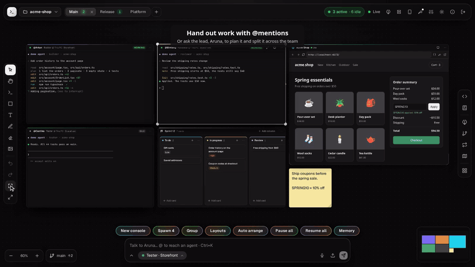</a>

<sub>Send work with an @mention, watch the agent work in its terminal, and read its report in the thread.</sub>

**[▶ Watch the product tour](docs/media/demo.mp4)** (73 s, MP4) · [Releases](https://github.com/azamrizki/nextboard/releases) · [Report an issue](https://github.com/azamrizki/nextboard/issues)

</div>

> [!NOTE]
> **Beta.** Real-world testing has been on Linux; macOS builds exist but are untested. APIs and data formats may still change. This README describes the current source tree, which can be ahead of the latest release.

## Why NextBoard

- **See every agent at once.** Each console shows whether its agent is working, needs you or is ready, so you stop opening terminals to find the one that waits.
- **Work keeps running.** Agents run on the hub machine, not in the browser. Close the tab and pick up later from another computer or your phone.
- **Direct a team, not a tab.** Send work with an @mention or ask the lead agent to plan it. Reports come back to the thread.
- **One project, even across machines.** A storefront on your PC and its API on a server stay one project, with one memory and one lead.
- **Yours.** One Go binary on your machine, with your agent logins or your own API keys. No account and no cloud service in between.

## Quick start

**1. Install an agent CLI** you already use, such as [Claude Code](https://github.com/anthropics/claude-code) or [Codex](https://github.com/openai/codex), and log in to it.

**2. Install NextBoard:**

```bash
curl -fsSL https://raw.githubusercontent.com/azamrizki/nextboard/main/install.sh | sh
```

The script checks the release's SHA-256, puts `nextboard` in `~/.local/bin`, sets up a service (systemd user service on Linux, LaunchAgent on macOS) and prints a one-time setup link, valid for 30 minutes. Add `-s -- --no-service` after `sh` to install only the binary.

**3. Open the setup link**, choose the admin password and name your hub. Lost the link? `nextboard setup-link` makes a new one.

**4. Add a project and start consoles.** Pick one folder, or several named parts across your machines. Start an agent, then send it a task from its tile or the command bar (`Ctrl/⌘K`).

| Default | Value |
|---|---|
| Hub address | `http://127.0.0.1:12312` (plain HTTP, loopback only) |
| Data folder | `~/.nextboard`, or `$NEXTBOARD_HOME`; `~/.nextboard-<name>` for another [instance](#several-instances-on-one-machine) |
| Other devices | Through HTTPS in nginx or a private network such as Tailscale; see [Security](#security) |

### Update

`nextboard update` installs the latest stable release and restarts the service. The web does the same: the label at the end of the header (`v0.9.0 · 3f2a1c9`, the build that runs; on a phone, **… › About this hub**) opens About this hub, with the version, the commit, the build time and, when a newer release is out, an **Update to vX.Y.Z** button for the admin. It downloads the release, checks its SHA-256, replaces the binary (the old one stays as `nextboard.old`) and restarts the hub. Consoles reconnect, agents come back asleep or resume, and data and logins stay. A beta follows the newest beta, or the stable release after it; a dev build updates with `git pull`. The button needs a hub run by the service that `nextboard install` sets up. With [several instances](#several-instances-on-one-machine), both ways restart every instance that runs the binary and name them first. To go back, `nextboard update --version <tag> --force`.

> [!TIP]
> No subscription? Claude Code, Codex and OpenCode consoles can run on an Anthropic- or OpenAI-compatible API with a key of your own. See [API providers](#api-providers).

<details>
<summary><b>Try a beta release</b></summary>

Betas are GitHub pre-releases; `nextboard update` never installs one by itself. Replace `vX.Y.Z-beta.N` with a tag from the [releases page](https://github.com/azamrizki/nextboard/releases):

```bash
nextboard update --version vX.Y.Z-beta.N
# or, for a new install
curl -fsSL https://raw.githubusercontent.com/azamrizki/nextboard/main/install.sh | sh -s -- --version=vX.Y.Z-beta.N
```

</details>

<details>
<summary><b>Build from source</b></summary>

You need Go 1.26+, Node.js 22+ and git.

```bash
git clone https://github.com/azamrizki/nextboard.git
cd nextboard
make build
./bin/nextboard serve     # prints the setup link in a terminal
./bin/nextboard install   # or run it as a service
```

Do not use `go install`. It builds a hub without the web UI, because the built bundle is not in the repository.

</details>

<details>
<summary><b>Optional tools</b></summary>

| Tool | Used for |
|---|---|
| `tmux` on a server | Shells that survive SSH disconnects and hub restarts |
| `bubblewrap` (`bwrap`) | Claude Code's sandbox, and keeping an API provider's key out of the commands Claude Code runs |
| `gh` | Publishing to GitHub and pull requests |
| Language servers and debuggers (`gopls`, `pyright`, `typescript-language-server`, `dlv`, `debugpy`, ...) | The code workbench; each is used when found on `PATH` |
| `sway`, `wayvnc`, `wf-recorder`, `xwayland` | Desktop apps in a tile, with a GPU |
| `tigervnc-standalone-server`, `openbox` | Desktop apps in a tile, without a GPU |
| `ffmpeg` with VA-API, PipeWire | Hardware video and sound in desktop tiles |

</details>

### Several instances on one machine

One machine can run separate hubs, for example **work** and **personal**. Each instance has its own data folder, port, service, admin password, agent logins, projects and consoles, and they do not log each other out. One installed binary runs them all.

**Install a second instance** from a terminal:

```bash
nextboard install --instance work
# or, with the install script
curl -fsSL https://raw.githubusercontent.com/azamrizki/nextboard/main/install.sh | sh -s -- --instance=work
```

It creates `~/.nextboard-work`, picks the next free block of ports, starts the `nextboard-work` service and prints that instance's setup link. From the web, the admin of an existing instance opens **About this hub › New instance…**, picks a name, a hub name, the address and the port, confirms with the admin password, and gets the new instance's setup link. An instance made from the web listens on the same address as the one that made it, so it is reached the same way (over Tailscale, say); choose **This machine only** for loopback.

| | Default instance | Instance `<name>` |
|---|---|---|
| Data and config | `~/.nextboard`, `~/.nextboard/config.json` | `~/.nextboard-<name>`, `~/.nextboard-<name>/config.json` |
| Hub address | `127.0.0.1:12312` | `127.0.0.1:12412` for the first, `12512` for the second, … |
| Preview ports | `12320–12339` | in the same block: `12420–12439`, … |
| Service | `nextboard` (macOS: `id.nextboard`) | `nextboard-<name>` (macOS: `id.nextboard.<name>`) |
| Logs | `journalctl --user -u nextboard` | `journalctl --user -u nextboard-<name>` |
| Browser cookie | `nb_session_http`, `nb_session` | `nb_session_http_<name>`, `nb_session_<name>` |

**Ports.** Each instance gets a block of 100 ports: the hub on `12312 + 100·k`, its previews from `12320 + 100·k`. A block that is busy, or claimed by another instance, is skipped. `--listen` picks the address yourself; `install` refuses a port or a `--status-listen` address that another instance uses. Names are lowercase letters, digits and `-`, up to 24 characters; `default` means `~/.nextboard`.

**The wizard.** Every new instance starts with the setup wizard:
1. **Claim it**: the setup code, the hub name (`<hostname> · <name>` to start with) and the admin password. The instance's name is fixed by then.
2. **How its agents sign in**: separate NextBoard logins for this instance (the default, kept in its data folder), your own CLI logins (`~/.claude`, `~/.codex`, shared with your terminal and every instance that makes the same choice), or an API provider kept in this instance.
3. **Copy from another instance** on this machine, with that instance's admin password: settings, custom agents and layouts, and MCP servers are ticked; SSH machines, API providers, every secret (MCP values, SSH keys and passwords, API keys) and the vault only when you tick them. The admin login, the master key, paired devices, projects, boards, consoles and memory are never copied.
4. **Agent CLIs found** on This PC.
5. **Summary**: the instance, its data folder, config file, service, port and addresses.

The default instance on a machine without other instances keeps the short first run: steps 1 and 4.

About this hub shows the same rows at any time, with the other instances on This PC (to the admin) and a link to each.

**Commands.** Every command takes `--instance <name>`, for example `nextboard status --instance work`, `nextboard logs --instance work -f` or `nextboard setup-link --instance work`. `nextboard instances` (`--json`) lists them all, with state, address, version, data folder and service, and warns about two with the same name or overlapping ports; `nextboard status --all` shows each one's status. Typed in a console of an instance, `nextboard …` acts on that instance.

**Update.** `nextboard update`, or **Update** in About this hub, replaces the one binary and restarts every instance that runs it, after naming them. `nextboard update --instance work` restarts only that one and names the others still on the old build; About this hub of an instance that still runs it says *Updated on disk since this hub started*.

**Remove one.** `nextboard uninstall --instance work` stops and removes only that service; its data folder stays. Add `--purge` to delete `~/.nextboard-work` too; it refuses while that hub still runs. The other instances are not touched.

> [!IMPORTANT]
> **Instances keep data and accounts apart, not secrets.** Every instance of one OS user runs as that user, so an agent in *personal* can read `~/.nextboard-work`, its master key included, and both use your `~/.ssh`, git and `gh` credentials. For real secrecy, run the instance as an OS user of its own, with its own agent CLIs and logins (Linux):
>
> ```bash
> sudo useradd --create-home --shell /bin/bash nb-work
> sudo loginctl enable-linger nb-work
> sudo -iu nb-work env XDG_RUNTIME_DIR=/run/user/$(id -u nb-work) \
>   sh -c 'curl -fsSL https://raw.githubusercontent.com/azamrizki/nextboard/main/install.sh | sh -s -- --instance=work'
> ```
>
> Give it a name other than `default`: browsers keep cookies per host, not per port or user, so two `default` instances on one host log each other out.

## Features

[Agents and orchestration](#agents-and-orchestration) · [Code and review](#code-and-review) · [Projects across machines](#projects-across-machines) · [Project list](#project-list) · [Previews and apps](#previews-and-apps) · [Memory](#memory) · [Credentials](#credentials) · [Uptime](#uptime) · [Phones and tablets](#phones-and-tablets) · [Supported agents](#supported-agents)

### Agents and orchestration

- **Status at a glance.** `WORKING`, `NEEDS YOU` or `READY` on every console; `N` jumps to the agent that has waited longest.
- **Orders with @mentions.** The hub types an order only when the agent's prompt is on screen, never into a shell or a dialog, and posts the reply to the thread.
- **A lead agent** plans, splits the work and forwards results, and asks first only when a plan could do damage. Plain commands such as `spawn 3 codex reviewers` work without it.
- **Teams.** Groups with roles, handoffs, loops, task boards, Mission Map, and layout templates that deploy a whole team.
- **Light with many agents.** An idle agent nobody is watching sleeps after 30 minutes and resumes its conversation when you open it, type or send it work. Consoles on screen share a budget of GPU contexts, so a large board keeps drawing.

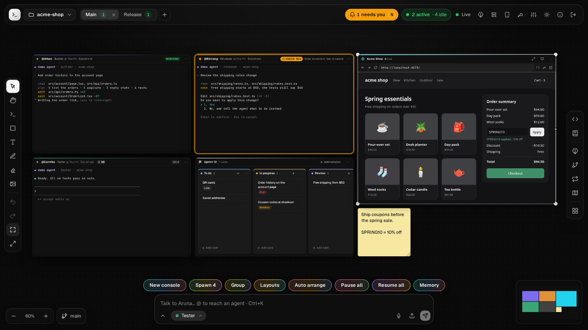

<p align="center"><sub>Every agent on one canvas</sub></p>

<table>
<tr>
<td width="50%" align="center">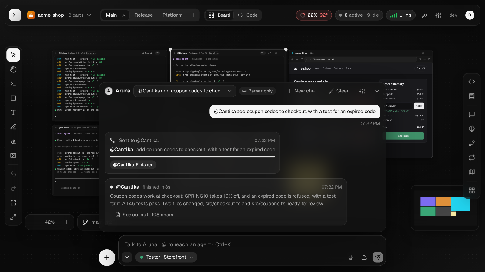<br><sub>An @mention order and the report it brings back</sub></td>
<td width="50%" align="center">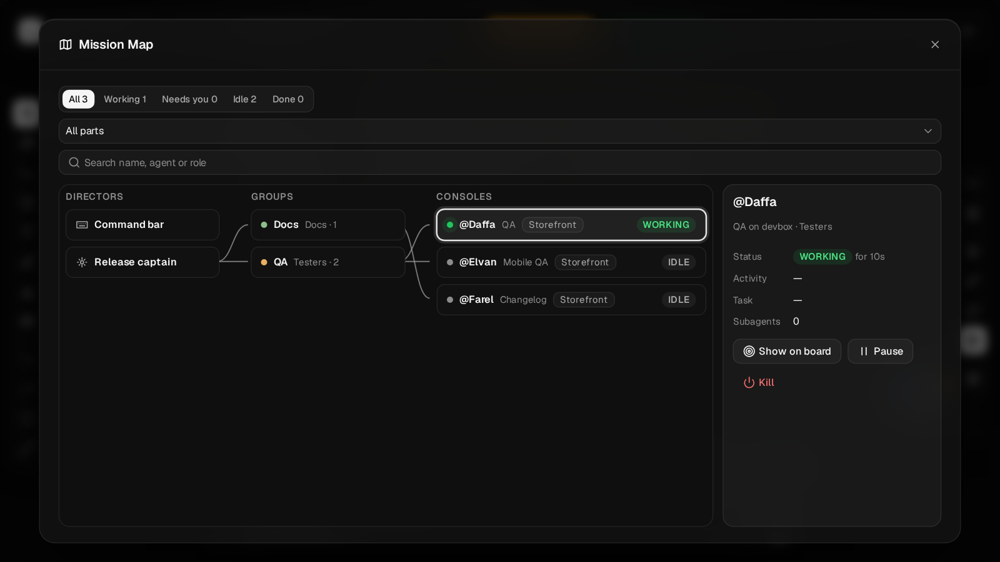<br><sub>Directors, groups and consoles at a glance</sub></td>
</tr>
<tr>
<td width="50%" align="center">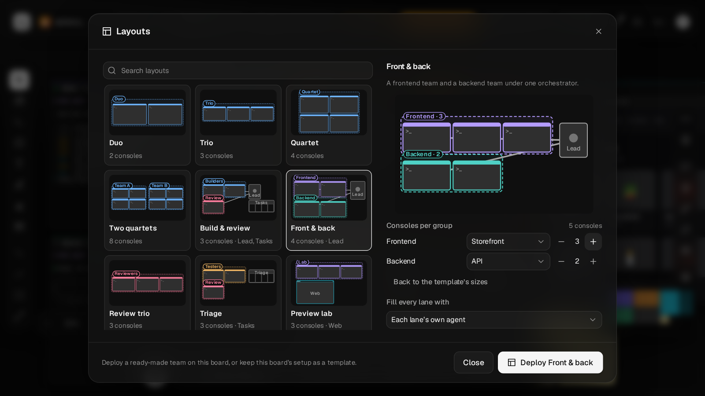<br><sub>Choose a layout, place each group and size it</sub></td>
<td width="50%" align="center">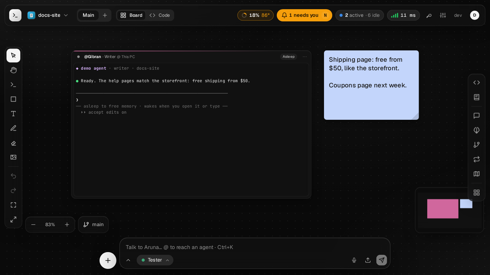<br><sub>Sleeping agents</sub></td>
</tr>
</table>

### Code and review

- **An editor for the whole project.** Monaco with each part's own language servers and debuggers, search, tasks, ports and a terminal panel. An editor card at the project root shows every part as a folder; a card in one part shows only that part. Cards that show the same file share its unsaved edits. Open VSX themes and grammars load as data; extension code never runs.
- **Review.** Each agent's changes, file by file, to keep or undo, for every CLI and for folders without git.
- **Local History.** Every earlier state of a file, to compare and restore.
- **Git.** Stage single changes, commit, push, stash, resolve conflicts, browse the graph and open pull requests through `gh`. Discard moves files to a trash; it never deletes. The board's Git panel lists every part's repository, each with its branches, stash and history graph.

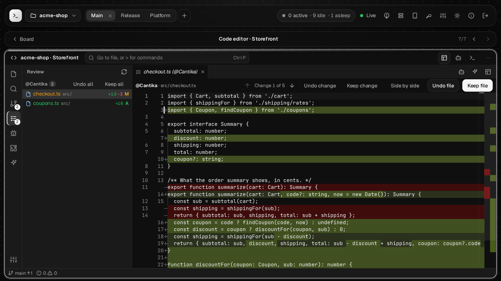

<p align="center"><sub>Each agent's changes, file by file, to keep or undo</sub></p>

<table>
<tr>
<td width="50%" align="center">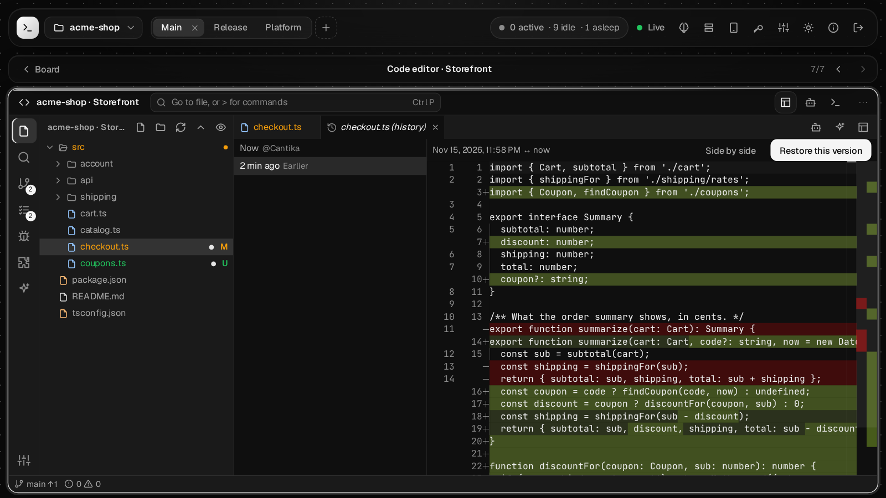<br><sub>Every earlier state of a file, whoever wrote it</sub></td>
<td width="50%" align="center">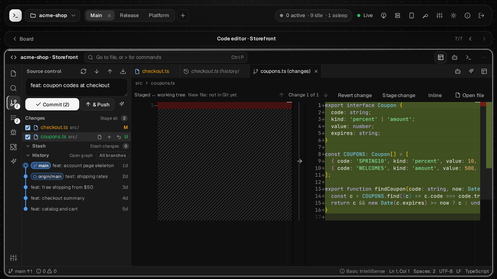<br><sub>Stage, commit and push from the code card</sub></td>
</tr>
<tr>
<td width="50%" align="center">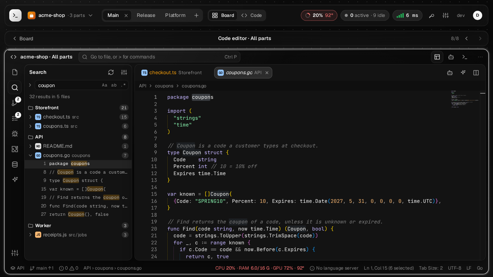<br><sub>The editor at the root: one search across every part</sub></td>
<td width="50%" align="center">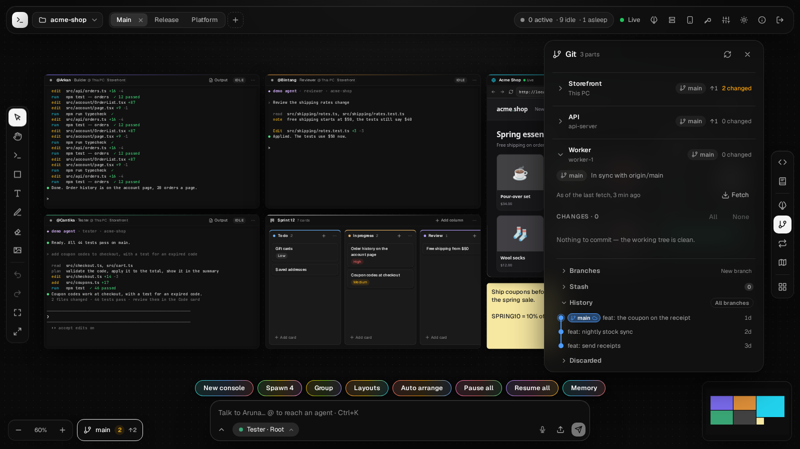<br><sub>Every part's repository in the board's Git panel</sub></td>
</tr>
</table>

### Projects across machines

A project holds up to eight named parts, each a folder on This PC or on an SSH machine. All parts are equal: rename, reorder, split off or remove any of them, as long as one is left.

| Part | Machine | Folder |
|---|---|---|
| Storefront | This PC | `~/apps/acme-shop` |
| API | api-server | `/srv/acme-api` |
| Worker | worker-1 | `/srv/acme-worker` |

- **One root.** The project is a root with one folder per part: `acme-shop/Storefront`, `acme-shop/API`, `acme-shop/Worker`. It is a view. Files stay on their machines and nothing is copied or synced. A project in one folder looks as it always did.
- **Root or part.** Consoles, groups, layouts and editor cards go at the root, where they reach every part, or in one part. In a project of several parts, every place that starts them asks *Place in: Root (all parts) / part* and remembers your last choice. The lead always works at the root.
- **At the root.** A root console runs on This PC in a folder the hub keeps: a link for each local part, a note for each server part, and an `AGENTS.md` / `CLAUDE.md` that lists every part and how to reach it. Server files are read and changed through the hub's tools over SSH, never copied.
- **Shared:** memory, critical notes, the lead, boards, monitors and credentials. **Per part:** files, git, review, Local History and language servers.
- **Direct work by part.** `spawn 2 claude in API` opens two consoles there, an order that names no part goes to the root, and Mission Map filters by part. Saved layouts remember each group's part by name and ask when a project lacks it.
- **Access.** An agent may change its own part and other parts on its machine. Parts on other machines are read-only for it unless you allow full access. A part can be read-only for everyone, such as a production server. At the root, each part's own rule applies. These are hub rules with [limits](#security).
- **Merge and split.** Merge another project in as parts while its consoles keep running, or split a part out. Files stay where they are ([contract](docs/API-board.md#1-project--workspace)).

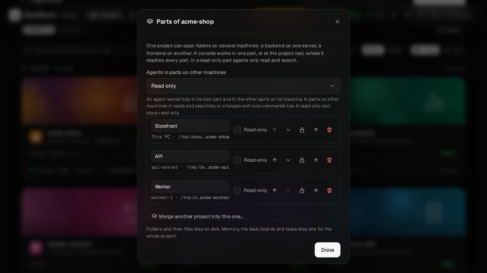

<p align="center"><sub>One project, three parts, three machines</sub></p>

<table>
<tr>
<td width="50%" align="center">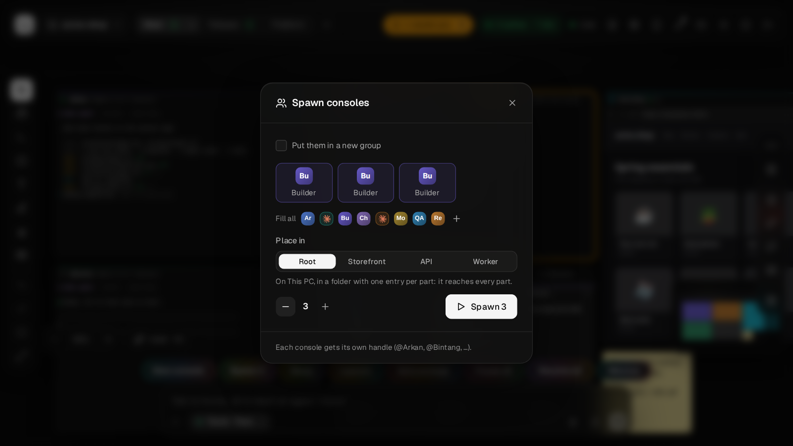<br><sub>Every place that starts consoles asks: Root or a part</sub></td>
<td width="50%" align="center">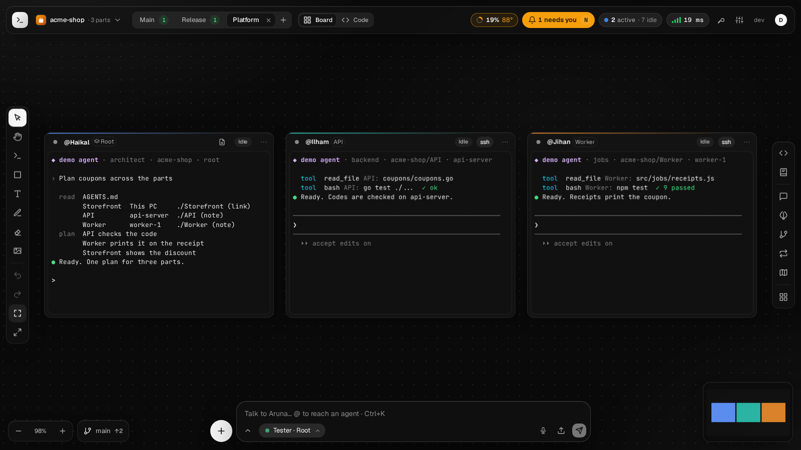<br><sub>A console at the root beside consoles in two server parts</sub></td>
</tr>
</table>

### Project list

- **Covers and icons.** Give a project's card a cover and an icon: upload a picture, or let **Create with AI** make one with the hub's Codex when it can generate images. Without one, the card shows a quiet gradient and a monogram.
- **One card for a project in parts.** Its parts sit in one row, such as `3 parts · 3 machines`, and its git row adds up every repository. Click the row for each part's folder, machine and status. Arrange the list by host or by your groups.
- **Many at once.** **Select** picks projects, Shift a run and Ctrl/⌘ one more; the bar at the bottom archives them, deletes them permanently or moves them to a group. Machines and groups have the same select mode.
- **Archive or delete.** An archived project's consoles stop, while its boards, memory and history wait under **Archived** until you restore it. Delete permanently lists what goes and asks you to type `delete`. Folders and files on disk stay either way.

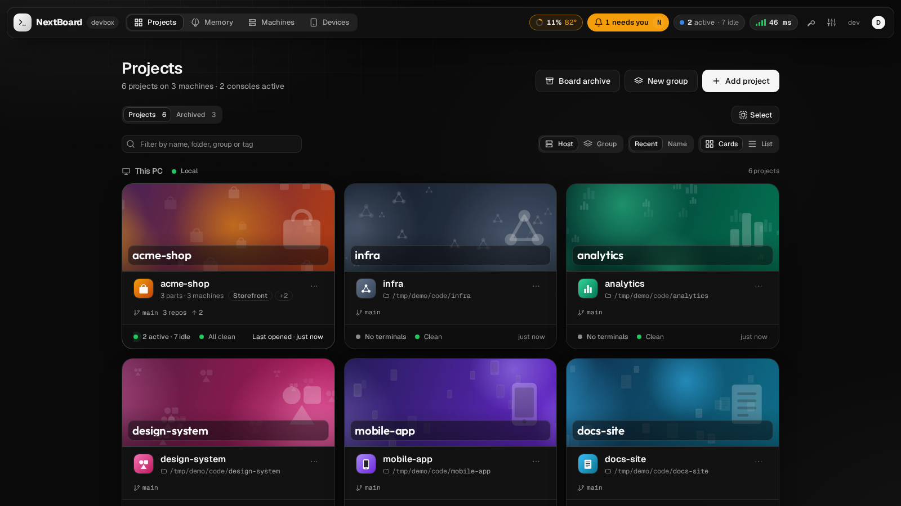

<p align="center"><sub>Covers, icons, and one card for a project in three parts</sub></p>

<table>
<tr>
<td width="50%" align="center">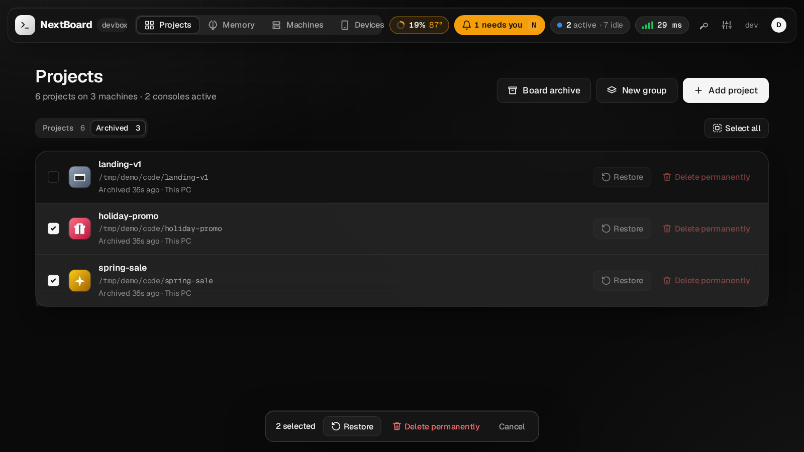<br><sub>Select mode and the Archived view</sub></td>
<td width="50%" align="center">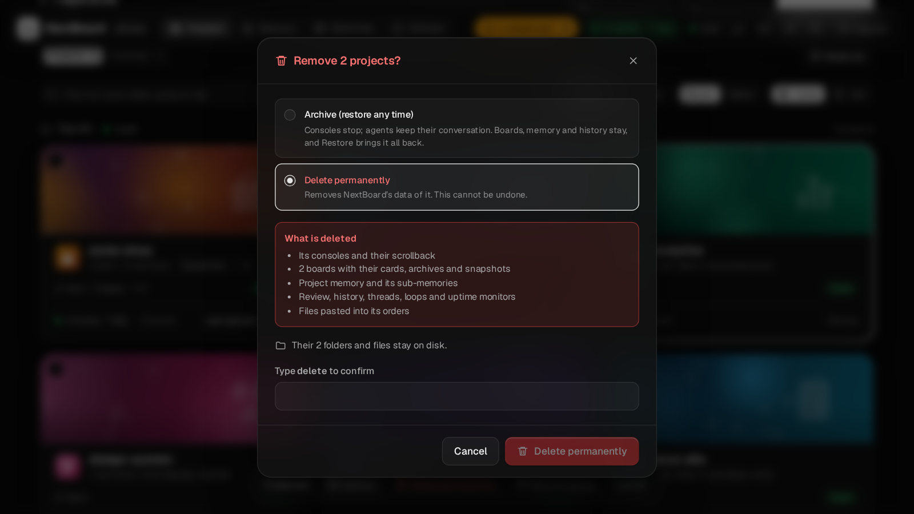<br><sub>Archive, or delete permanently</sub></td>
</tr>
</table>

### Previews and apps

- **Live previews.** A localhost URL in a console's output becomes a web tile, on This PC or over SSH, with the page's console and network log.
- **Real browsers and desktop apps.** Sites that refuse iframes open in a real browser tile: NextBoard Chromium, which the hub downloads on request and keeps updated, or your Chrome, Chromium or Firefox. Other GUI apps stream into tiles with sound and microphone. These tiles need Linux.

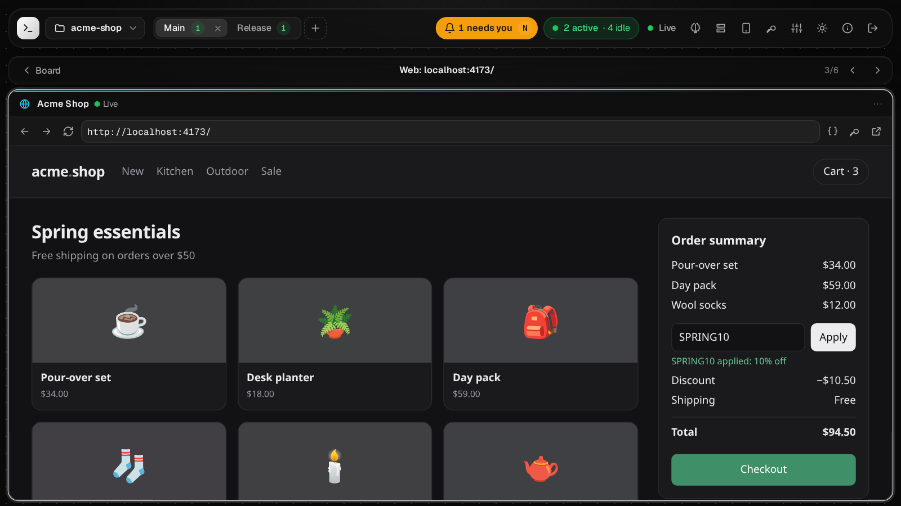

<p align="center"><sub>Live preview</sub></p>

### Memory

- **One memory per project**, whatever the CLI: a main memory and sub-memories per topic that agents look up when they need them.
- **Critical notes** reach every agent first and in full, and only you change them. They are instructions, not a lock.
- **Init** proposes facts and rules from the project. Nothing is saved until you accept it.
- **Memory tiles** add other projects' memory. The hub types only the facts an agent does not have yet.

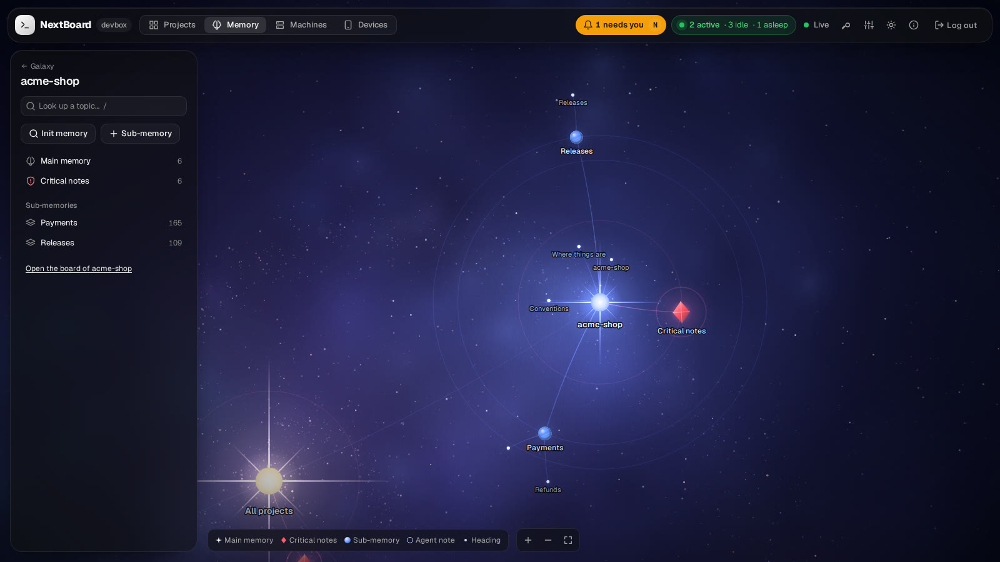

<p align="center"><sub>Explore shared memory and its connections</sub></p>

### Credentials

- **Zero-knowledge vault.** Encrypted in your browser with a master password; the hub stores only ciphertext. Logins with TOTP, cards, identities, notes and SSH keys, with Bitwarden import and export.
- **Agents use a secret without seeing it.** You approve one command in the browser; the hub runs it and censors the output.
- **Passkeys and form filling** in browser tiles. The vault works over plain HTTP too, with a warning.

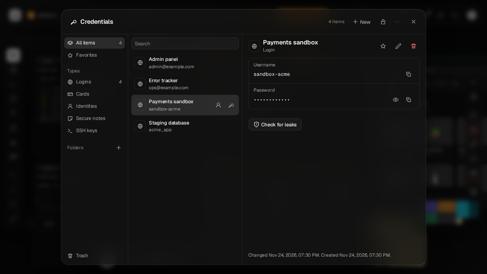

<p align="center"><sub>Credentials vault</sub></p>

### Uptime

- HTTP, TCP, ping, DNS, push, WebSocket, Docker and Steam game-server checks, run by the hub even with no browser open. HTTP, TCP and ping can run from a server over SSH.
- Alerts and maintenance windows.
- **A public status page** on a listener of its own: monitor names and uptime, never a host, an address or an error.

<table>
<tr>
<td width="50%" align="center">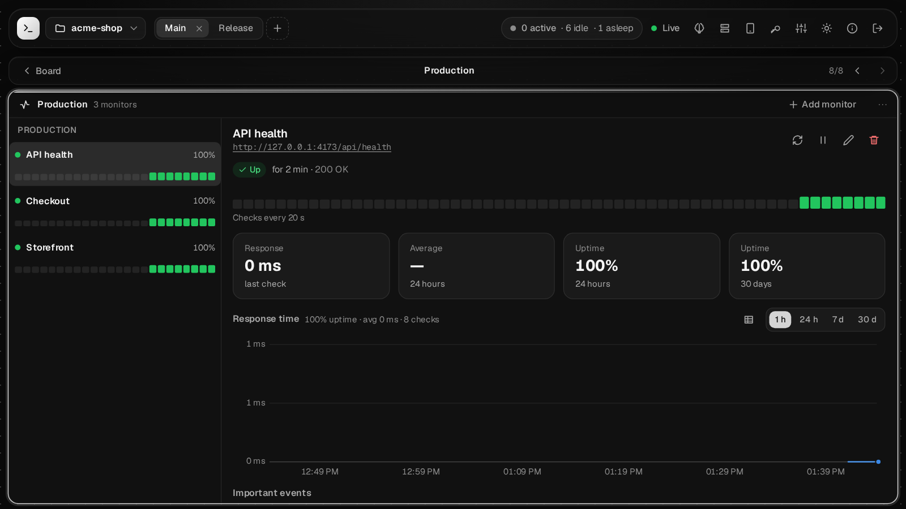<br><sub>Uptime monitors</sub></td>
<td width="50%" align="center">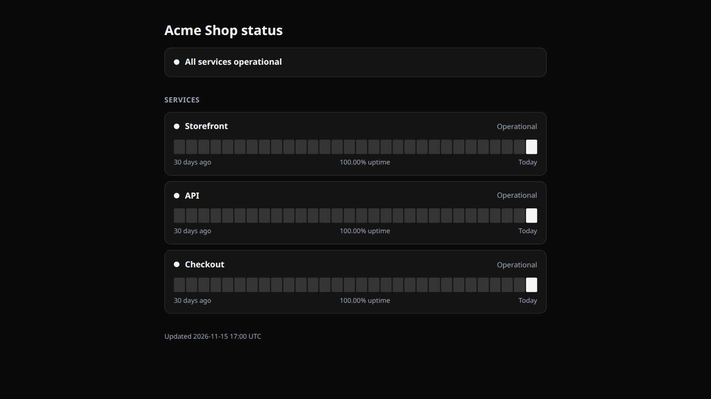<br><sub>Public status page</sub></td>
</tr>
</table>

### Phones and tablets

- A layout of its own for every page. On a phone the board is a canvas or a Cards list, with tabs at the bottom.
- Key bars for consoles and the editor, and notifications when an agent needs you.
- Install it as an app over HTTPS. Over plain HTTP you get a home screen shortcut and a warning.

<p align="center">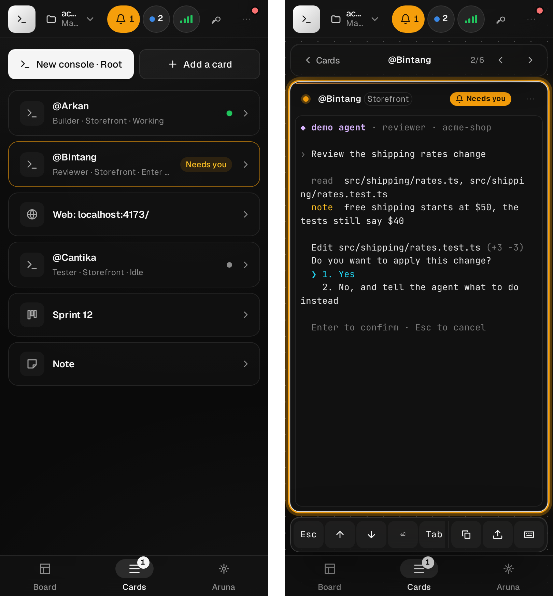</p>

<p align="center"><sub>On your phone</sub></p>

### Supported agents

| Agent | Integration |
|---|---|
| **Claude Code**, **Codex** | Most tested: live status, exact conversation resume, project memory, remote tools, project sandbox and API providers |
| **OpenCode** | Remote tools and API providers; less real-world testing |
| **Gemini CLI** | Built-in preset with screen-based status; not yet tried with the real CLI |
| **Catalog and custom CLIs** | Aider, Amp, GitHub Copilot CLI, Goose, Qwen Code and more; capabilities vary by CLI |

Capabilities and limits per agent: [API-agents.md](docs/API-agents.md).

**Also included:** Documents (to PDF) and Diagrams studios, a Markdown vault with a link graph, a skills manager, MCP servers set up once for Claude Code, Codex and OpenCode, usage and token charts, voice input, and light and dark themes.

<sub>The screenshots and video come from a demo hub with made-up projects and scripted agents. Recreate them with `make demo` ([web/demo](web/demo)).</sub>

## How it works

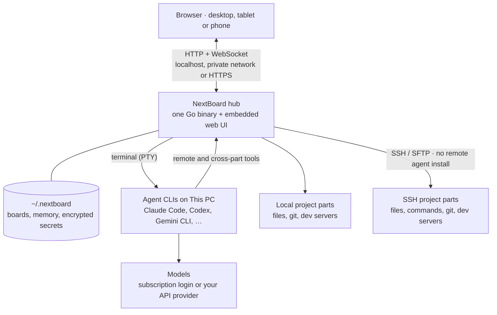

The hub starts each agent CLI in its own terminal on **This PC**, tracks its state and delivers your orders. For parts on a server, Claude Code, Codex and OpenCode use hub tools to read files and run commands over SSH; their CLI, login and memory stay on the hub machine. Servers need only SSH, with no NextBoard service or agent CLI to install. Plain shells on a server can use tmux to survive disconnects.

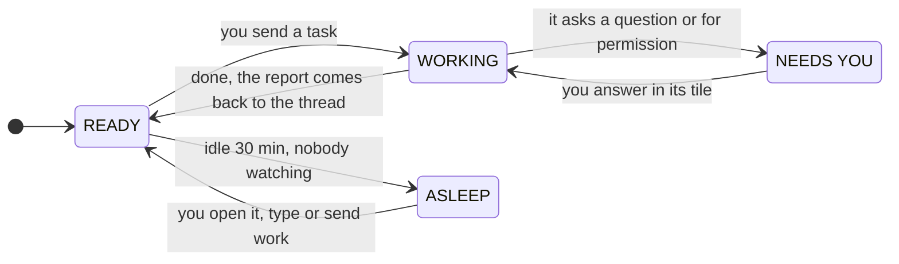

Agents of your two most recent projects stay awake, as does a console set to **Keep awake**.

<details>
<summary><b>Data layout</b></summary>

Everything lives in one folder (mode 0700), `~/.nextboard-<name>` for [another instance](#several-instances-on-one-machine). Files are 0600, written atomically, in plain JSON with no database.

```
~/.nextboard/
  config.json  settings.json         instance name, hub id, listen address; hub settings
  hub.lock                           held while a hub runs on this folder, so only one does
  auth.json  secret.key              admin login, the hub's master key
  machines.json  known_hosts  creds/ SSH machines, accepted host keys, sealed credentials
  projects.json  sessions.json       projects with their parts, consoles
  scrollback/                        console output, kept across restarts
  boards/  snapshots/  archive/      boards, hourly snapshots, closed boards
  assets/                            pasted and uploaded images
  threads/  orders.json  loops.json  lead threads, orders, loops
  memory/                            project memory, sub-memories, critical notes
  agents/  profiles/                 agent CLI state and login profiles
  providers.json  providers/         API providers (keys sealed) and their CLI folders
  review/                            shadow repos behind Review and Local History
  vault.json                         credentials vault, ciphertext only
  uptime/                            monitors and their history
  gui/  browsers/                    desktop app profiles, NextBoard Chromium
  logs/connections.jsonl             connection log
```

</details>

## API providers

Run Claude Code, Codex or OpenCode on an API key of your own instead of a subscription login. Claude Code and Codex get a config folder of their own per provider, so your logins are neither used nor changed.

| Agent | Needs |
|---|---|
| Claude Code | An Anthropic-compatible API (`/v1/messages`) |
| Codex | An OpenAI-compatible API **with the Responses API** (`/v1/responses`); Codex no longer speaks Chat Completions |
| OpenCode | Either |

1. **Settings › API providers › Add provider**: the address, the key, a default model, and optionally prices per model and a monthly budget. **Test the connection** lists its models.
2. **Start a console on it**: pick **API · *name*** where you choose the login (new console, spawn, layouts, handoff, switch agent). The tile shows **API · $cost**.
3. **Optional**: Settings › Lead agent › *What it runs on* puts the lead and the consoles it starts on a provider. Settings › Previews & studios › *Run through* does the same for other hidden runs (memory, summaries, commit messages, documents).

Once a month's budget is spent, new consoles, restarts and hidden runs on that provider are refused; nothing moves to your subscription by itself. Claude Code consoles on a provider start in *accept edits* mode, because its default auto mode checks each action on Anthropic's servers, which a gateway does not reach. With `bubblewrap` installed, Claude Code holds the console in its default mode instead; this is the setting that keeps the key out of its commands. The hub then allows the same edits by permission rules, and for a yolo console the built-in tools and MCP servers. The mode line reads default, and file commands such as `mkdir` or `mv` ask. Details: [API providers contract](docs/API-agents.md#102-api-providers-2026-11-11).

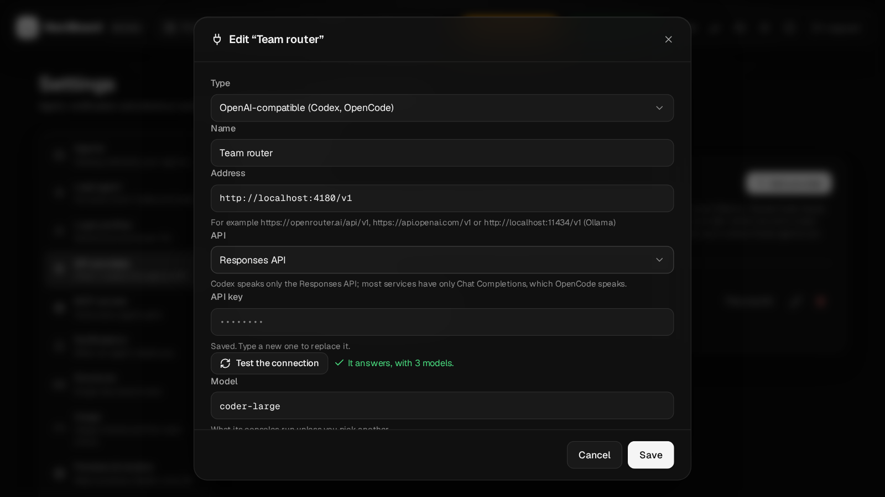

<p align="center"><sub>API providers</sub></p>

## Security

> [!WARNING]
> **NextBoard is effectively a shell on your machine. Do not expose its port to the internet.**

- **Network.** The hub speaks plain HTTP and binds to `127.0.0.1` by default. For remote access, put it behind HTTPS with nginx ([`deploy/nginx.conf.example`](deploy/nginx.conf.example)) or use a private network such as Tailscale. `tailscale serve` only forwards the main port, so web tiles do not work through it.
- **Development.** `make dev` binds to `0.0.0.0` by default. On an untrusted network, use `make dev LISTEN=127.0.0.1:12312`.
- **Agent access.** Agents run as your user and can read everything that user can, including NextBoard's data folder and the data folders of your [other instances](#several-instances-on-one-machine). Critical notes, blocked commands and read-only parts are not an OS security boundary: a CLI's own local tools may reach other folders on the same machine. Read the [agent access rules](docs/API-agents.md#211-project-parts-roadmap-49) before you rely on them.
- **Project sandbox.** Memory › Critical notes › Sandbox restricts local Codex and Claude Code commands to the working folder, temporary folders and package caches, with or without network. Claude Code needs bubblewrap and, on some Ubuntu systems, an AppArmor step. Other CLIs and SSH work are not covered; see [sandbox limits](docs/API-agents.md#27-agent-sandbox-2026-11-11).
- **Credentials vault.** Encryption happens in the browser and the hub stores only ciphertext. If you forget the master password, the contents are gone. Letting agents use a credential guards against accidents, not against an agent set on stealing it. See [what it does not protect against](docs/API-vault.md#what-it-does-not-protect-against).
- **API keys.** Provider keys are sealed with the hub's master key and reach only the agent process that uses them, never a browser, a command line or a log. Commands run by Codex, or by Claude Code with `bubblewrap` installed, do not get the key; OpenCode's commands do. An agent set on finding it can still read it from its own process.
- **Status page.** Only the status page may face the internet, on a listener of its own (`--status-listen`, example in [`deploy/nginx-status.conf.example`](deploy/nginx-status.conf.example)). It shows the names you chose for your monitors and their uptime, never a host, an address or an error message.

Please report security problems through a [private security advisory](https://github.com/azamrizki/nextboard/security/advisories/new), not a public issue.

## CLI

`nextboard help` lists the commands. Every command accepts `--instance <name>` (its data folder is `~/.nextboard-<name>`) and `--data-dir` (default `~/.nextboard`, or `$NEXTBOARD_HOME`). See [Several instances on one machine](#several-instances-on-one-machine).

<details>
<summary><b>Command reference</b></summary>

| Command | Purpose |
|---|---|
| `nextboard serve [--listen addr] [--status-listen addr]` | Run in the foreground |
| `nextboard install [--instance name] [--listen addr] [--public-url url] [--status-listen addr]` | Install the service and print a setup link; with `--instance`, a new instance with its own data folder, ports and service |
| `nextboard uninstall [--instance name] [--purge]` | Remove that instance's service; `--purge` also deletes its data folder, and refuses while its hub runs |
| `nextboard status [--instance name \| --all]` | Service state, address, and session, machine and device counts |
| `nextboard instances [--json]` | Every instance on this machine: state, address, version, data folder, service, and conflicts such as overlapping ports |
| `nextboard logs [-f]` | Service logs |
| `nextboard connlog [--machine name] [-n count] [--json]` | Server connection history: drops, reconnects, latency; works while the hub is down |
| `nextboard setup-link` | Create a new one-time setup link |
| `nextboard reset-password` | Reset the admin password; every browser logs in again |
| `nextboard pair` | Print a QR code and pairing code for a device |
| `nextboard update [--version tag] [--force] [--instance name]` | Install the latest stable release, or the one named, and restart every instance's service that runs this binary (with `--instance`, only that one) |
| `sudo nextboard browser-sandbox [--instance name]` | Let NextBoard Chromium make its sandbox where Ubuntu 23.10+ restricts it; only needed without a Chrome or Chromium installed from a package |
| `nextboard version` | Print the version, channel, commit and build time |

`serve --debug-listen 127.0.0.1:6060` serves the hub's Go profiles and a few counts (`/debug/pprof/`, `/debug/hub`) for looking into its memory. It is off unless given, takes only a loopback address, and answers no request from a web page. Each instance needs an address of its own.

</details>

## Development

You need **Go 1.26+**, **Node.js 22+** and git. From a source checkout, install the frontend dependencies and the Go reloader, then start the hub and Vite together:

```bash
npm ci --prefix web
go install github.com/air-verse/air@latest
make dev
```

The web UI runs at `http://localhost:15173`, the hub at `http://localhost:12312`, and development data lives in `./.devdata`. Saving a Go file restarts the hub; `RELOAD=0` turns that off. The dev hub is the [instance](#several-instances-on-one-machine) `dev`, with a cookie of its own (`nb_session_http_dev`), so it never logs your browser out of an installed hub on the same host; log in to it once after upgrading from a checkout without instances.

By default the tests never touch a real agent CLI or your agent plan. `NEXTBOARD_REAL_CLI_TEST=1` turns on tests that do, and these use your real account.

<details>
<summary><b>Make targets</b></summary>

```bash
make dev        # hub and Vite together, with live reload
make dev-hub    # hub only
make dev-web    # Vite only
make test       # go vet + go test -race
make test-fast  # the same, the slow packages split and run side by side: a few minutes
make test-web   # web unit tests; needs web/node_modules
make test-e2e   # browser tests with fake agents; needs `cd web && npx playwright install chromium` once
make test-e2e-fast  # the same over several hubs side by side (E2E_SHARDS=n): ~10 min instead of ~30
make test-ssh   # SSH tests against a throwaway local sshd
make test-db    # database browser tests against throwaway MySQL and PostgreSQL containers (Docker)
make demo       # the screenshots and the video in docs/media, from a hub of made-up data; needs ffmpeg
make build      # web + bin/nextboard
make snapshot   # goreleaser build for linux/darwin, amd64/arm64
```

</details>

<details>
<summary><b>Releases</b></summary>

CI runs only as part of a release, so run the tests yourself before you push. A release is started by hand from GitHub Actions: it runs all the tests, works out the version from the commit messages with [semantic-release](https://semantic-release.gitbook.io/), tags it and publishes the binaries with goreleaser.

Commits use [Conventional Commits](https://www.conventionalcommits.org/): `fix:` gives a patch release, `feat:` a minor one, and `docs:`, `test:`, `ci:` and `chore:` none. Until 1.0, a breaking change (`feat!:`) also gives a minor release.

A beta comes from the `beta` branch: `git push origin main:beta`, then `gh workflow run release.yml --ref beta`. It is published as a `vX.Y.Z-beta.N` pre-release, so `nextboard update` and the install script keep giving the last stable release.

</details>

<details>
<summary><b>Repository layout</b></summary>

```
cmd/nextboard/      entry point
internal/cli/       subcommands, service install, update
internal/server/    router, auth middleware, REST, WebSocket, hub tools for agents
internal/session/   terminals, scrollback, resume, sleep and wake
internal/machine/   local PTY and agentless SSH
internal/project/   projects, groups, parts, merge and split
internal/agent/     agent catalog, status, hooks
internal/orch/      command bar, lead and planner, orders, loops, memory
internal/jobs/      hidden runs of the agent CLIs (planner, summaries, commit messages)
internal/providers/ API providers: sealed keys, prices, budgets
internal/delivery/  typing orders into consoles
internal/studio/    code workbench and studios
internal/review/    agent review and Local History
internal/gitsvc/    git panel and GitHub
internal/preview/   web tile proxy
internal/gui/       desktop apps and browsers in a tile
internal/vault/     credentials vault storage
internal/uptime/    monitors, alerts and public status pages
web/                React + TypeScript + Vite UI
web/demo/           the made-up hub behind the screenshots and the video
docs/               specification and API contracts
deploy/             nginx, systemd and launchd examples
```

Android and desktop clients are separate projects, not published yet, and not part of this repository.

</details>

## Documentation

Start with [PROJECT.md](docs/PROJECT.md) for an overview; use the API contracts for current endpoint behavior.

| Document | Contents |
|---|---|
| [PROJECT.md](docs/PROJECT.md) | Overview: how it works, features, limits, status and known gaps |
| [SPEC.md](docs/SPEC.md) | Original specification: network, auth, SSH |
| [ROADMAP.md](docs/ROADMAP.md) | Phases and design decisions |
| [DESIGN.md](docs/DESIGN.md) | Design system |
| [API.md](docs/API.md) | Core API, authentication, devices and machines |
| [API-board.md](docs/API-board.md) | Projects, parts, merge and split, workspaces, board operations and assets |
| [API-agents.md](docs/API-agents.md) | Agent catalog, sessions, remote tools, access rules, providers, sandbox and sleeping agents |
| [API-orchestration.md](docs/API-orchestration.md) | Lead agent, orders, handoffs, loops, memory and layouts |
| [API-studio.md](docs/API-studio.md) | Workbench, git, previews, language servers, debuggers and studios |
| [API-gui.md](docs/API-gui.md) | Desktop apps, browser tiles and media streaming |
| [API-vault.md](docs/API-vault.md) | Encrypted credentials, agent access and passkeys |
| [API-uptime.md](docs/API-uptime.md) | Monitors, alerts, maintenance and public status pages |

## Contributing

Issues and pull requests are welcome. CI does not run on pull requests, so please run `make test` and `make test-web` before you open one. Use [Conventional Commits](https://www.conventionalcommits.org/), and keep the matching `docs/API*.md` accurate when a contract changes.

## License

[MIT](LICENSE) © 2026 Azam Rizki

Third-party components keep their own licenses. Most dependencies are MIT, ISC, BSD or Apache-2.0. Others include noVNC (MPL-2.0), DOMPurify (MPL-2.0 or Apache-2.0), and the Geist, Geist Mono, JetBrains Mono and Caveat fonts (OFL-1.1).

Agent names and logos belong to their owners and are used only to identify those tools. NextBoard is not affiliated with or endorsed by any of them.

<div align="center">

[Back to top ↑](#nextboard)

</div>
